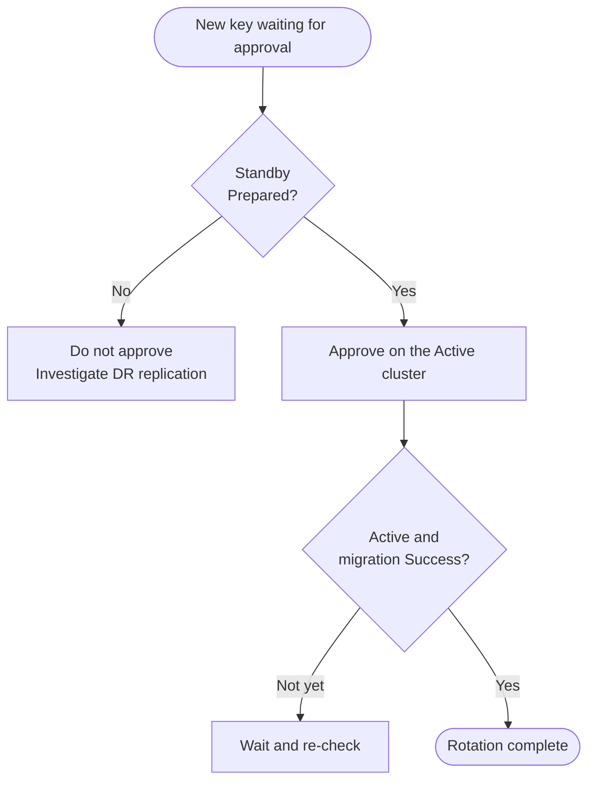

{/* cspell:ignore urandom */}

# etcd Encryption

Install and operate Control Plane Database Encryption in <Term name="productShort" textCase="upper" /> to automate etcd data encryption key rotation within your clusters.

It ensures that sensitive data stored in etcd, such as secrets and configmaps, is encrypted using a secure algorithm, enhancing your cluster's security.

## How it Works

Upon installation, an `etcd-encryption-manager` controller is deployed in the `kube-system` namespace, which:

* Periodically rotates etcd data encryption keys.
* Retains the 8 most recent keys for rollback compatibility.
* Updates encryption configurations on all control plane nodes.
* Triggers `kube-apiserver` to hot reload new keys.
* Automatically migrates resources to re-encrypt data with new keys.

Cluster stability is maintained throughout these operations.

When the plugin is installed in `deterministic` mode on a `global` DR pair, the controller additionally:

* Detects whether it is acting as **Active** or **Standby** at runtime — this is not a manual configuration.
* On the Active side, generates the SeedBundle and lets the Global Cluster Disaster Recovery plugin replicate it to the Standby.
* On the Standby side, derives the same per-revision keys from the shared SeedBundle and the root Secret, so a failover produces identical encryption keys without manual key copy.

### Default Configuration

| Parameter            | Value               |
| -------------------- | ------------------- |
| Encrypted resources  | secrets, configmaps |
| Encryption algorithm | 256-bit AES-GCM     |
| Rotation interval    | 168 hours (7 days)  |

## Choose a Key Strategy

The plugin can be installed on clusters on non-Alauda OS nodes and on clusters created by the DCS provider. The key strategy depends on the cluster:

| Strategy | When to use | How keys are produced |
| --- | --- | --- |
| `random` | Default for workload clusters. | Each rotation generates a fresh random key locally. |
| `deterministic` | **Required** for the `global` cluster, whether or not it is part of a Global DR pair. | Each key is derived from a root Secret and a SeedBundle. In a Global DR pair, the Active and Standby clusters share both, so they always reach the same key for the same revision. |

When `global.cluster.name` is `global`, the plugin enforces `etcdEncryption.keyStrategy=deterministic`; the plugin form also defaults Key Strategy to `deterministic` for clusters labeled `is-global=true`. In `deterministic` mode, the runtime Active / Standby role is detected automatically; it is not an install parameter.

## Install on Workload Clusters

Install the plugin via the standard [Cluster Plugin](/extend/cluster_plugin.mdx) workflow with the default key strategy `random`. No additional installation parameters are required.

## Install on the global Cluster \{#global-deterministic}

These steps apply to every `global` cluster. If the `global` cluster is part of a Global DR pair, also follow [Additional Requirements for a Global DR Pair](#global-dr-pair).

<Steps>

### Generate the Replication Group ID \{#step-replication-group-id}

`replication_group_id` identifies the replication group: the `global` cluster alone, or the Active and Standby clusters of a Global DR pair. The plugin form prefills the current cluster name, but do **not** keep it: to avoid leaking real business, environment, or cluster identity, use a separate opaque identifier. A UUID-style identifier may be a good fit, for example `6f1b9e2c-7c3a-4a9c-8b72-2fd0f8f3c1ab`.

To generate a UUID-style value from the command line:

```bash
openssl rand -hex 16 | sed -E 's/^(.{8})(.{4})(.{4})(.{4})(.{12})$/\1-\2-\3-\4-\5/'
```

### Prepare the Root Secret \{#step-root-secret}

The deterministic root Secret must exist in `kube-system` before installing the plugin.

1. Generate 32 bytes of cryptographically strong random material into `./root-key.bin`.

   ```bash
   (umask 077 && openssl rand -out ./root-key.bin 32)
   ```

   The bytes must come from a high-entropy source — typically the operating system CSPRNG. `openssl rand` is a safe default; equivalent OS-CSPRNG-backed commands such as `head -c 32 /dev/urandom > ./root-key.bin` also work. Do **not** use shell `$RANDOM`, language-level `rand()`, or any time-seeded generator.

2. Create the Secret:

   ```bash
   kubectl -n kube-system create secret generic etcd-derivation-root \
     --from-file=root-key=./root-key.bin
   ```

   If you use a different Secret name, replace `etcd-derivation-root` with the value you will enter as `root_secret_name`.

### Install the Plugin \{#step-install}

Install the plugin via the [Cluster Plugin](/extend/cluster_plugin.mdx) workflow, with the following form values:

| Plugin parameter | Value |
| --- | --- |
| `key_strategy` | `deterministic` |
| `replication_group_id` | The value from [Generate the Replication Group ID](#step-replication-group-id). |
| `root_secret_name` | The Secret name from [Prepare the Root Secret](#step-root-secret). Default: `etcd-derivation-root`. |
| `activation_policy` | `manual` for a Global DR pair. `timed-approval` for a `global` cluster without DR. The form defaults to `manual` on the `global` cluster. |
| `approval_delay_minutes` | Used only with `timed-approval`. Default `60` on the `global` cluster; minimum `30`. |

With `manual`, a new key revision does not become active until an operator approves it — see [Approve a Deterministic Key Rotation](#approving-a-deterministic-key-rotation). In a Global DR pair, this ensures the Standby cluster has loaded the key first. Without DR there is no Standby to wait for, so `timed-approval` activates each rotation automatically after the approval delay.

For a description of every parameter, see [Plugin Parameters](#plugin-parameters).

</Steps>

### Additional Requirements for a Global DR Pair \{#global-dr-pair}

<Directive type="warning" title="Configure both DR clusters identically">

Install the plugin **on both the Active and Standby clusters**, with the **same** `replication_group_id` and the **same** root key material. Generate each value **once** and reuse it on both clusters. Asymmetric or mismatched configuration causes the Standby to derive different per-revision keys than the Active and breaks failover.

</Directive>

* The **Global Cluster Disaster Recovery** plugin must be installed.
* Use the same `replication_group_id` on the Active and Standby clusters.
* Generate `./root-key.bin` **once**, transport the **same** file to both clusters, and create the root Secret on each. Do **not** regenerate the key material per cluster.
* Set `activation_policy` to `manual` on both clusters, because the Standby becomes the Active after a failover.

## Check Rotation Status

Run the following command to check the current rotation status:

```bash
kubectl get EtcdEncryptionConfig default -o yaml
```

Example output:

```yaml
apiVersion: cluster.alauda.io/v1alpha1
kind: EtcdEncryptionConfig
metadata:
  name: default
spec:
  resources:
    - secrets
    - configmaps
  rotationInterval: 168h0m0s
  type: aesgcm
status:
  deployStatus:
    192.168.100.1:
      revision: 3
      state: Success
    192.168.100.2:
      revision: 3
      state: Success
    192.168.100.3:
      revision: 3
      state: Success
  migration:
    completeTimestamp: "2025-05-27T05:47:01Z"
    resources:
      - secrets
      - configmaps
    revision: 3
    state: Success
  revision: 3
```

## Approve a Deterministic Key Rotation \{#approving-a-deterministic-key-rotation}

When the encryption manager rotates a key in `deterministic` mode, the new revision enters a `WaitingApproval` phase on the Active cluster. The key does not take effect until it is approved. This gate exists because the Active cluster must not encrypt data with a key that the Standby cluster has not yet loaded — otherwise a failover would leave Standby unable to decrypt the new ciphertext.



Approval is always performed on the **Active cluster only**. Do not patch the Standby's `EtcdKeySeedBundleState`, and do not edit any resource's `status` field directly.

For a `global` cluster without DR, there is no Standby: skip the Standby checks below, or use [Timed Approval](#timed-approval).

## Manual Approval \{#manual-approval}

<Steps>

### Identify the Pending Revision

Log in to a control-plane node of the **Active** cluster and list all bundle states:

```bash
kubectl get eksbs \
  -o custom-columns='NAME:.metadata.name,REVISION:.spec.revision,PHASE:.status.phase,APPROVED:.spec.approved'
```

Find the row with `PHASE=WaitingApproval` and `APPROVED=false`. Record its revision number:

```bash
REVISION=<revision-number>
STATE="seed-bundle-state-${REVISION}"
BUNDLE="seed-bundle-${REVISION}"
```

### Verify Standby Readiness

Log in to a control-plane node of the **Standby** cluster and check the same revision:

```bash
kubectl get eksbs "$STATE" \
  -o custom-columns='REVISION:.spec.revision,PHASE:.status.phase,PREPARED_AT:.status.preparedAt'
```

The output must show `PHASE=Prepared` for the expected revision. **Stop** if the object is missing, still `Preparing`, or `Failed` — investigate the Global Cluster Disaster Recovery replication path before proceeding.

### Cross-check Derivation Inputs

Run the following command on **both the Active and Standby clusters** and compare the output. The `replicationGroupID`, `dimension`, and `derivationAlgorithm` must match exactly:

```bash
kubectl get eksb "$BUNDLE" \
  -o custom-columns='REVISION:.spec.revision,GROUP:.spec.replicationGroupID,DIMENSION:.spec.dimension,ALGORITHM:.spec.derivationAlgorithm'
```

### Approve the Revision

On the **Active** cluster, approve the pending revision:

```bash
kubectl patch eksbs "$STATE" \
  --type=merge -p '{"spec":{"approved":true}}'
```

The patch records the approval. Activation, deployment to control-plane nodes, and data migration happen asynchronously after this point.

### Confirm Activation Completes

On the **Active** cluster, check the bundle state and migration progress:

```bash
kubectl get eksbs "$STATE" \
  -o custom-columns='REVISION:.spec.revision,PHASE:.status.phase,MESSAGE:.status.message'
kubectl get eec default \
  -o custom-columns='REVISION:.status.revision,MIGRATION_STATE:.status.migration.state,MIGRATION_REVISION:.status.migration.revision'
```

The rotation is complete when:

* The bundle state reaches `PHASE=Active`.
* `eec/default` shows the new `REVISION` with `MIGRATION_STATE=Success`.

To check per-node deployment progress on the **Active** cluster:

```bash
kubectl get eec default \
  -o go-template='{{range $node, $status := .status.deployStatus}}{{printf "%s\t%s\t%d\t%s\n" $node $status.state $status.revision $status.message}}{{end}}'
```

Every control-plane node must report `state=Success` for the new revision. A bundle that remains `Activating` indicates deployment or migration is still in progress (or retrying after a failure).

</Steps>

## Timed Approval \{#timed-approval}

`timed-approval` is the recommended policy for a `global` cluster without DR.

<Directive type="warning" title="Timed approval risks data loss during a DR failover">

`timed-approval` is **not recommended** for Global Active/Standby pairs. The approval delay timer is a local countdown on the Active cluster — it does not check whether the Standby has actually loaded the new key. If etcd synchronization is slow, the Standby network is partitioned, or the Standby control plane is under maintenance, the deadline can expire while the Standby is still unprepared. A failover during this window leaves Standby unable to decrypt data encrypted with the new key.

</Directive>

When `activation_policy` is `timed-approval`, the controller automatically approves the pending revision once `approval_delay_minutes` elapses after the `EtcdKeySeedBundleState` is created. In a Global DR pair, the delay must be long enough for the full Standby preparation pipeline to complete:

| Phase | What happens | Typical duration |
| --- | --- | --- |
| Sync | The Global Cluster Disaster Recovery plugin replicates the SeedBundle to Standby | Seconds (depends on cross-region latency) |
| Reconcile | Standby controller derives the key and updates local EncryptionConfig | Seconds |
| Deploy | Deployer writes the new provider config to all Standby control-plane nodes | Seconds to minutes (scales with node count) |
| Reload | Standby kube-apiserver loads the new provider | Seconds to minutes (depends on whether automatic reload is enabled for the encryption provider config) |

The delay is at least 30 minutes; the form defaults to 60 minutes on the `global` cluster. Increase it if your setup involves cross-region replication, large control planes, or clusters without automatic provider reload.

### Required Monitoring

If a Global DR pair uses `timed-approval`, you **must** verify that monitoring and alerting are working on **both** the Active and Standby clusters before enabling this policy. See [Metrics](#metrics) and [Built-in Alert Rules](#built-in-alert-rules) for what the plugin provides.

The alert to act on is `EtcdEncryptionManagerTimedApprovalDeadlineApproaching` on the **Active** cluster — it gives you a 10-minute window to check whether the Standby is `Prepared` and switch to `manual` if it is not.

<Directive type="info" title="Cross-cluster correlation">

Each cluster runs its own metrics and alerting independently. The built-in alerts detect local issues — a stuck `WaitingApproval` on Active or a failed activation on Standby. To correlate the two (e.g., "Active is about to auto-approve but Standby is not yet `Prepared`"), aggregate metrics from both clusters into a central Prometheus / Thanos / Victoria Metrics instance.

</Directive>

### Emergency Response

If the `EtcdEncryptionManagerTimedApprovalDeadlineApproaching` alert fires and the Standby is not ready, switch the **Active** cluster to `manual` to halt auto-approval. On the **Active** cluster, set `activation_policy` in the plugin configuration:

```bash
MI=$(kubectl get moduleinfo \
  -l cpaas.io/module-name=etcd-encryption-manager,cpaas.io/cluster-name=global \
  -o jsonpath='{.items[0].metadata.name}')
kubectl patch moduleinfo "$MI" \
  --type=merge -p '{"spec":{"config":{"activation_policy":"manual"}}}'
```

Do not patch `eec/default` directly; the plugin configuration can overwrite the change.

Confirm that the new policy has reached the encryption configuration. The command prints `manual`:

```bash
kubectl get eec default -o jsonpath='{.spec.deterministic.activationPolicy}'
```

Then verify that the current pending bundle has not been approved:

```bash
kubectl get eksbs \
  -o custom-columns='NAME:.metadata.name,REVISION:.spec.revision,PHASE:.status.phase,APPROVED:.spec.approved'
```

The bundle must still show `APPROVED=false`. Switching back to `timed-approval` later affects only future bundles — the current bundle remains under manual control. If the bundle has already moved to `Activating`, the deadline has already taken effect; follow the [activation checks](#manual-approval) above and do not assume that changing the policy rolls it back.

## Reference

### Plugin Parameters \{#plugin-parameters}

| Plugin parameter | Required | Default | Purpose |
| --- | --- | --- | --- |
| `key_strategy` | Yes | `random`; defaults to `deterministic` for clusters labeled `is-global=true`. | `random`: single-cluster random rotation. `deterministic`: derived keys based on a root Secret and SeedBundle. Must be `deterministic` for the `global` cluster. |
| `replication_group_id` | Yes, for `deterministic` | The plugin form prefills the current cluster name (not recommended). | Identifies the replication group and participates in HKDF domain separation. Must be identical on the Active and Standby clusters of a Global DR pair. |
| `root_secret_name` | Yes, for `deterministic` | `etcd-derivation-root` | Name of the Secret that holds the deterministic root key material. All clusters in the same replication group must use the same root key material. |
| `activation_policy` | Yes, for `deterministic` | `manual` for clusters labeled `is-global=true`; otherwise `timed-approval`. | How a new derived key becomes active. See [Approve a Deterministic Key Rotation](#approving-a-deterministic-key-rotation). |
| `approval_delay_minutes` | Yes, for `timed-approval` | `60` for clusters labeled `is-global=true`; otherwise `30`. Minimum `30`. | Delay before a pending revision is approved automatically under `timed-approval`. |

The Secret namespace (`rootSecretRef.namespace`) is fixed to `kube-system` and is not exposed in the form.

### Advanced Chart Values

<details>
<summary>Show advanced chart values</summary>

The following fields exist in the chart but are not surfaced as plugin install parameters. They retain their chart defaults unless you install via YAML / Helm overrides.

| Chart field | Default | Purpose |
| --- | --- | --- |
| `etcdEncryption.deterministic.derivationAlgorithm` | `hkdf-sha512-v1` | Algorithm used to derive per-revision keys from the root Secret. |
| `etcdEncryption.deterministic.dimension` | `default` | Additional HKDF domain separator. Leave at the default unless you need to fork a key lineage on purpose. |
| `etcdEncryption.deterministic.rootSecretRef.namespace` | `kube-system` | Fixed; not exposed by the form. |

</details>

### Custom Resources

| Kind | Short name | Purpose |
| --- | --- | --- |
| [EtcdEncryptionConfig](/apis/kubernetes_apis/security/etcdencryptionconfig.mdx) | `eec` | Encryption settings and rotation status, in the object named `default`. |
| [EtcdKeySeedBundle](/apis/kubernetes_apis/security/etcdkeyseedbundle.mdx) | `eksb` | Derivation inputs for one key revision in `deterministic` mode. |
| [EtcdKeySeedBundleState](/apis/kubernetes_apis/security/etcdkeyseedbundlestate.mdx) | `eksbs` | Approval and activation phase for one key revision in `deterministic` mode. |

### Configuration Files

| Path                                              | Content                                   |
| ------------------------------------------------- | ----------------------------------------- |
| `/etc/kubernetes/encryption-provider.conf`        | Current encryption configuration          |
| `/etc/kubernetes/encryption-provider-history.bak` | Historical key records (for recovery)     |
| `/etc/kubernetes/encryption-provider-bak/`        | Expired encryption configuration versions |

### Metrics \{#metrics}

The encryption manager exposes the following Prometheus metrics:

| Metric | Type | Description |
| --- | --- | --- |
| `etcd_encryption_manager_bundle_waiting_approval_seconds` | Gauge | Seconds the current bundle has remained in `WaitingApproval`. Labeled by `activation_policy` (`manual` or `timed-approval`). |
| `etcd_encryption_manager_timed_approval_remaining_seconds` | Gauge | Seconds remaining before the timed-approval deadline expires. Negative values mean the deadline has passed. Only emitted when a `timed-approval` bundle is in `WaitingApproval`. |
| `etcd_encryption_manager_bundle_activating` | Gauge | `1` when any bundle is currently in the `Activating` phase. |
| `etcd_encryption_manager_bundle_activation_failed` | Gauge | `1` when an `Activating` bundle has an explicit deployment or migration failure. |

### Built-in Alert Rules \{#built-in-alert-rules}

The plugin includes the following alerts. They fire on each cluster independently.

| Alert | Severity | Condition |
| --- | --- | --- |
| `EtcdEncryptionManagerApprovalRequired` | warning | A `manual` bundle has been in `WaitingApproval` for ≥ 5 minutes. |
| `EtcdEncryptionManagerApprovalOverdue` | critical | A `manual` bundle has been in `WaitingApproval` for ≥ 30 minutes. |
| `EtcdEncryptionManagerTimedApprovalDeadlineApproaching` | warning | A `timed-approval` bundle has ≤ 10 minutes remaining before auto-approval. |
| `EtcdEncryptionManagerTimedApprovalDeadlinePassed` | critical | A `timed-approval` bundle's deadline has passed while still in `WaitingApproval`. |
| `EtcdEncryptionManagerActivationFailed` | critical | An `Activating` bundle has a deployment or migration failure. |
| `EtcdEncryptionManagerActivationStuck` | critical | A bundle has remained `Activating` for ≥ 30 minutes. |
