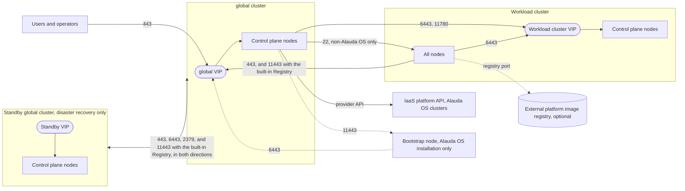

# Communication Matrix

This page is the single reference for the network access that <Term name="productShort" /> requires. Other pages link here instead of listing ports themselves. It has two parts:

- [Network Flows](#network_flows) are the connections that have to be allowed **between** machines and networks — through site firewalls, security groups, router ACLs, and load balancers. They are listed by the endpoint that receives the traffic, and they apply to every cluster, whatever operating system its nodes run, unless a row says otherwise. Use them to request network and security approvals before you install the `global` cluster or create a workload cluster.
- [Node Ports](#node_ports) are the ports that platform components listen on **on each node**, which is what a host firewall on the node has to allow. This part differs between [Alauda OS nodes](#node_ports_alauda_os) and [non-Alauda OS nodes](#node_ports_non_alauda_os).

Every port on this page is TCP unless stated otherwise. In the tables, **Needed when** states the condition under which a row applies. A row marked **Always** applies to every deployment. If the condition of a row does not describe your deployment, you do not need to open that row. The sections that apply to a single scenario, [Installation](#installation) and [Infrastructure Providers](#infrastructure_providers), state the scenario in their introduction instead.

## Decide What Applies to You \{#applicability}

Your choices decide which rows you need. Settle them before you request network approvals.

| Decision | Choice | What it changes |
| --- | --- | --- |
| Operating system of the nodes | Alauda OS | The `global` cluster is installed from a bootstrap node, see [Installation](#installation), and clusters are created through an infrastructure provider, see [Infrastructure Providers](#infrastructure_providers). The node host firewall is preconfigured, see [Alauda OS Nodes](#node_ports_alauda_os) |
| Operating system of the nodes | non-Alauda OS | The `global` cluster deploys the nodes of a workload cluster over SSH, see [Workload Cluster VIP and Nodes](#workload_cluster). The installer runs on a node of the `global` cluster, see [Installation](#installation). If you enable a host firewall, see [Non-Alauda OS Nodes](#node_ports_non_alauda_os) |
| Control plane endpoint | External load balancer | Forward the ports that the tables in [Platform Access Address and `global` VIP](#global_vip) and [Workload Cluster VIP and Nodes](#workload_cluster) mark in the **Forward on load balancer** column |
| Control plane endpoint | `Self-built VIP` | No load balancer listeners. See [Self-built VIP](#self_built_vip) |
| Platform image registry | External image repository | See [Image Registry](#image_registry) |
| Platform image registry | Platform built-in Registry, the default | Adds the `11443` rows |
| Global disaster recovery | Used | Adds the flows marked **Global DR** in [Platform Access Address and `global` VIP](#global_vip). See [Global Disaster Recovery](#global_dr) |
| HTTP access to the platform | Enabled. We do not recommend it; the platform uses HTTPS by default | Adds the `80` rows |

## Overview \{#overview}

The diagram shows the steady-state flows between the main parties, plus the two flows of an Alauda OS installation that involve the bootstrap node. The other flows that exist only during installation are listed in [Installation](#installation). The tables in [Network Flows](#network_flows) give the source, port, purpose, and condition of each flow.

_Diagram: Steady-state network flows between users, the `global` cluster, a standby `global` cluster, a workload cluster, an external registry, and an IaaS platform, with the bootstrap node of an Alauda OS installation._

## Network Flows \{#network_flows}

Most tables list the traffic that arrives at one endpoint; [Installation](#installation), [Infrastructure Providers](#infrastructure_providers), and [Infrastructure Services](#infrastructure_services) list the flows of one scenario. Traffic that a load balancer forwards does not originate from a cluster node IP address, so allow it from the load balancer as well as from the cluster networks. We recommend configuring health checks on the load balancer for each forwarded port.

### Platform Access Address and `global` VIP \{#global_vip}

The platform access address is the `global` VIP, or the domain that resolves to it. If the `global` cluster also uses an External IP, the rows for `443`, `6443`, and `11443` apply to it as well.

Configure the load balancer to forward the ports marked **Yes** in **Forward on load balancer** from the VIP to **all control plane nodes** of the `global` cluster. With `Self-built VIP` there are no load balancer listeners; see [Self-built VIP](#self_built_vip). In the **Allowed from** column, **Global DR** marks the sources that a disaster recovery pair adds; see [Global Disaster Recovery](#global_dr).

| Port | Allowed from | Forward on load balancer | Purpose | Needed when |
| --- | --- | --- | --- | --- |
| `443`, or the custom HTTPS port set at installation | Users, operators, and external systems; nodes of workload clusters; Bare Metal hosts, which register through it, and workload cluster hosts, which also poll for their plans through it, see [Infrastructure Providers](#infrastructure_providers); **Global DR:** standby cluster nodes | Yes | Web console, platform API, Kubernetes API, and image registry access over HTTPS. Nodes and platform components of workload clusters reach the platform through it. If a workload cluster cannot reach the platform access address of the `global` cluster, add an address that it can reach, as described in [Creating an On-Premise Cluster](/configure/clusters/on-premises.mdx). With disaster recovery, **<Term name="product" /> etcd Synchronizer** reaches the active platform through this address, and logging and monitoring components send alert callbacks to it | Always. To use a custom HTTPS port, forward that port instead, and enter the same port in the installation parameters |
| `80` | Users, operators, and external systems; **Global DR:** standby cluster nodes | Yes | Platform HTTP access | Only when you enable HTTP access to the platform. We do not recommend it; the platform uses HTTPS by default |
| `6443` | Nodes of the `global` cluster; the bootstrap node during an Alauda OS installation; **Global DR:** standby cluster nodes | Yes | Kubernetes API server for the nodes of the cluster. During an Alauda OS installation, Cluster API reaches the control plane endpoint through it while the control plane is created. While **<Term name="product" /> etcd Synchronizer** is installed or reinstalled, the standby obtains the etcd CA material from the active cluster's API server | Always |
| `11443` | All nodes of every cluster that uses the platform built-in Registry; Bare Metal hosts that pull the Alauda OS image from it, see [Infrastructure Providers](#infrastructure_providers); **Global DR:** standby cluster nodes | Yes | Platform built-in Registry: nodes pull platform and plugin images | The `global` cluster uses the platform built-in Registry. Not needed when you use an external image repository instead of the one provided by the `global` cluster |
| `2379` | **Global DR:** standby cluster nodes. Forward it on the VIPs of both clusters of the pair | Yes. Only TCP (Layer 4) forwarding is supported; Layer 7 forwarding is not | etcd synchronization: **<Term name="product" /> etcd Synchronizer** reads etcd data from the active cluster and writes it to the local etcd | Global disaster recovery. If the standby reaches the etcd of the active cluster directly through **Active Global Cluster ETCD Endpoints**, allow `2379` to those addresses instead of forwarding it on the VIP |

On Huawei Cloud Stack, the HCS provider creates the `global` ELB listeners for clusters whose nodes run Alauda OS. See <ExternalSiteLink name="immutable-infra" href="/global/install.html" children="Installing the global Cluster" />.

### Workload Cluster VIP and Nodes \{#workload_cluster}

The `global` cluster manages every workload cluster, so the `global` cluster nodes must reach the VIP of each workload cluster and, for non-Alauda OS nodes, the nodes themselves over SSH.

**Workload cluster VIP.** Configure the load balancer to forward the ports marked **Yes** in **Forward on load balancer** from the VIP to **all control plane nodes** of the workload cluster.

| Port | Allowed from | Forward on load balancer | Purpose | Needed when |
| --- | --- | --- | --- | --- |
| `6443` | Nodes of the `global` cluster; all nodes of the workload cluster | Yes | Kubernetes API server of the workload cluster. The `global` cluster manages the workload cluster through it | Always |
| `11780` | Nodes of the `global` cluster | Yes | Platform traffic from the `global` cluster to the workload cluster, for example for monitoring | Always |

**Workload cluster nodes.**

| Port | Allowed from | Purpose | Needed when |
| --- | --- | --- | --- |
| `22` | Nodes of the `global` cluster | The `global` cluster deploys the nodes over SSH. If the nodes cannot be reached over SSH directly, provide a SOCKS5 proxy; see [Creating an On-Premise Cluster](/configure/clusters/on-premises.mdx) | The workload cluster has non-Alauda OS nodes. Alauda OS nodes are provisioned from an image and do not need this flow |

The nodes of a workload cluster also reach the platform access address of the `global` cluster, listed in [Platform Access Address and `global` VIP](#global_vip).

### Self-built VIP \{#self_built_vip}

`Self-built VIP` replaces the external load balancer with keepalived running on the control plane nodes. It configures no load balancer listeners. Instead of a TCP or UDP port, it uses the VRRP protocol (IP protocol number `112`) and moves the VIP with gratuitous ARP.

| Source | Destination | Port or protocol | Purpose | Needed when |
| --- | --- | --- | --- | --- |
| Control plane nodes that share the VIP | The other control plane nodes that share the VIP | VRRP, IP protocol `112` | Elects the node that holds the VIP | The cluster uses `Self-built VIP` |
| The control plane node that takes over the VIP | The subnet of the VIP | Gratuitous ARP | Announces the new location of the VIP, so that the other machines on the subnet update their ARP entries | The cluster uses `Self-built VIP` |

- Allow VRRP between all control plane nodes that share the VIP, and allow gratuitous ARP updates on their subnet. `firewalld` and `ufw` block VRRP by default, so on a non-Alauda OS node with a host firewall the VIP never comes up unless you allow it.
- Place all control plane nodes and the VIP in the same subnet. The VIP must differ from every node IP address.
- No load balancer listeners are configured. The flows to the VIP listed on this page still apply.

Clusters whose nodes run a non-Alauda OS support `Self-built VIP`. For the control plane endpoint modes that clusters whose nodes run Alauda OS support, see <ExternalSiteLink name="immutable-infra" href="/how-to/control-plane-endpoint.html" children="Plan the Control Plane Endpoint" />.

### Image Registry \{#image_registry}

The platform built-in Registry is served on the `global` VIP; see the `11443` row in [Platform Access Address and `global` VIP](#global_vip). The temporary registry on the bootstrap node of an Alauda OS installation is listed in [Installation](#installation). The registries below need their own flows.

| Registry | Source | Destination | Port | Needed when |
| --- | --- | --- | --- | --- |
| Platform built-in Registry through an external address | Workload cluster nodes that cannot reach the `global` cluster | The address configured in [Add External Address for Built-in Registry](/configure/clusters/how-to/add_external_addr_for_global_registry.mdx) | The port of that address | A workload cluster cannot reach the `global` cluster and the `global` cluster uses the platform built-in Registry |
| External image repository, used instead of the platform built-in Registry | The installer node or bootstrap node, and all nodes of every cluster that uses it | The registry address | The port in the registry address | An external image repository is used instead of the platform built-in Registry |
| **Private Repository** of a workload cluster | All nodes of that workload cluster | The registry address | The port in the registry address | The workload cluster is configured with a **Private Repository** |

### Global Disaster Recovery \{#global_dr}

A disaster recovery pair needs every flow marked **Global DR** in [Platform Access Address and `global` VIP](#global_vip). Allow them in **both directions** between the Primary and Standby cluster networks — on firewalls, security groups, router ACLs, and any other inter-site network controls — and forward them on both cluster VIPs as the **Forward on load balancer** column of that table says.

The rules must be bidirectional because the cluster roles are reversed after a failover: the former Primary becomes the new Standby and has to reach the new Primary on the same ports. This does not make etcd replication bidirectional — **<Term name="product" /> etcd Synchronizer** runs only on the current Standby Cluster and writes to its local etcd.

For the procedure, see [Global Disaster Recovery](../global_dr.mdx). For a `global` cluster whose nodes run Alauda OS, see <ExternalSiteLink name="immutable-infra" href="/global/disaster_recovery.html" children="Global Cluster Disaster Recovery" />.

### Within a Cluster \{#within_cluster}

| Source | Destination | Port | Purpose | Needed when |
| --- | --- | --- | --- | --- |
| All nodes of a cluster | The cluster's own VIP | `6443` | `kubelet` and cluster components reach the API server | Always |
| All nodes of a cluster | Every other node of the same cluster | The ports in [Node Ports](#node_ports), plus Pod and Service traffic | Cluster-internal traffic. Pod and Service traffic must not be filtered by port; see [Allow Cluster-Internal Traffic](#cluster_internal_traffic) | Always |

### Installation \{#installation}

These flows are needed only while the `global` cluster is being installed.

**Alauda OS.** `setup.sh` runs on a temporary bootstrap node that never joins the `global` cluster. In a disaster recovery deployment, each side is installed from its own bootstrap node, so allow these flows for both bootstrap nodes.

| Source | Destination | Port | Purpose |
| --- | --- | --- | --- |
| Operators | Bootstrap node | `22` | Run the installation |
| Bootstrap node | IaaS platform API | See [Infrastructure Providers](#infrastructure_providers) | The Cluster API providers run on the bootstrap node during installation and create the `global` cluster machines |
| Bootstrap node | `global` VIP | `6443` | Cluster API reaches the control plane endpoint while the control plane is created |
| `global` cluster nodes being provisioned | Bootstrap node | `11443` | Nodes pull the platform images from the registry on the bootstrap node until they switch to the platform image registry. This is the temporary registry of the bootstrap node, not the platform built-in Registry of the `global` cluster |
| `global` cluster hosts, Bare Metal only | Bootstrap node | `12443` | Elemental registration endpoint used during the bootstrap phase |

For the bootstrap node requirements, see <ExternalSiteLink name="immutable-infra" href="/global/install.html" children="Installing the global Cluster" />.

**Non-Alauda OS.** `setup.sh` runs on a node that becomes a control plane node of the `global` cluster.

| Source | Destination | Port | Purpose |
| --- | --- | --- | --- |
| Operators | Installer node | `8080` | Web console of the installer |
| Installer node | All other `global` cluster nodes | The ports in [Platform Ports](#platform_ports), including `22` | The installer deploys the nodes |

### Infrastructure Providers \{#infrastructure_providers}

Clusters whose nodes run Alauda OS are created through a Cluster API infrastructure provider. The provider runs on the bootstrap node while the `global` cluster is installed and on the `global` cluster afterwards, so allow these flows from the bootstrap node and from the `global` cluster nodes.

| Provider | Destination | Port | Purpose |
| --- | --- | --- | --- |
| Huawei DCS | DCS VRM virtual IP | `7443` | DCS REST API: cluster lifecycle calls and the first step of a file upload (`applyUpload`) |
| Huawei DCS | Management IP address of every DCS physical host that may receive a clone | The port returned by DCS, typically `8443`. Confirm it with the DCS administrator | Upload of the Ignition ISO to the URL returned by `applyUpload` |
| Huawei Cloud Stack | HCS API and IAM endpoints | The port of each endpoint | Resource lifecycle through the HCS API |
| VMware vSphere | vCenter | `443` | Machine lifecycle through the vSphere API |

If the `global` cluster nodes have several network interfaces, make sure that each destination is routable from the interface that reaches it.

**Bare Metal.** Hosts are registered, installed, and joined over the network, so open these flows before the first host boots the `SeedImage` ISO:

| Stage | Source | Destination | Port | Purpose |
| --- | --- | --- | --- | --- |
| First boot | Each host booted from the `SeedImage` ISO | Platform access address | `443`, or the custom HTTPS port | `elemental-register` registers the host and creates its `MachineInventory` |
| First boot of a `global` host during installation | Each `global` host | Bootstrap node | `11443` | `elemental install` pulls the Alauda OS image from the registry on the bootstrap node |
| First boot of a workload cluster host, and every reprovision of any host after the handoff | Each host | Platform image registry, at the address in `global.registry.address` | The port in the registry address, which is `11443` for the platform built-in Registry | `elemental install` and `elemental upgrade` pull the Alauda OS image |
| Provisioning and steady state | Each workload cluster host | Platform access address, path `/kubernetes/global` | `443`, or the custom HTTPS port | `elemental-system-agent` polls its plan Secret through the platform ingress, not through a direct connection to an API server |
| Steady state | Each `global` cluster host after handoff | The VIP of its own `global` cluster | `6443` | The system agent of a `global` host uses the local API server |

A Bare Metal host also needs DNS, NTP, the registry, its cluster's control plane endpoint, and cluster-internal traffic, as listed in the other sections of this page. A firewall approval that covers only `443` produces hosts that register successfully and then fail during installation or join.

### Infrastructure Services \{#infrastructure_services}

| Source | Destination | Port | Purpose | Needed when |
| --- | --- | --- | --- | --- |
| All nodes, and the installer node or bootstrap node | DNS servers | `53`, UDP and TCP | Name resolution of the platform access address, the registry, and other endpoints | Always |
| All nodes | NTP servers | `123`, UDP | Time synchronization. A production cluster should not depend on public NTP servers | Always |
| Platform alerting components | The notification endpoints you configure, such as a mail server or a webhook receiver | The port of each endpoint | Alert delivery | You configure notification endpoints |

### What This Matrix Does Not Cover \{#not_covered}

Check each of the following against your own deployment. A requirement that applies to your cluster but is not listed here still has to be allowed.

- **Pod and Service traffic.** See [Allow Cluster-Internal Traffic](#cluster_internal_traffic).
- **Secondary and non-default container networks.** The `6081/UDP` port in [Node Ports](#node_ports) is used by the default Kube-OVN Geneve tunnel. If you change the Kube-OVN tunnel type, or attach a secondary network with Multus on top of the default one, those networks carry Pod traffic between node IP addresses using their own encapsulation, which is not listed here. Confirm what your configuration uses and allow it between the nodes.
- **Application traffic.** Ports exposed by your applications through an ingress controller, a gateway, or `NodePort` and `LoadBalancer` Services are defined by those applications.
- **Agnostic extensions.** Ports required by Agnostic extensions are maintained by those extensions.

## Node Ports \{#node_ports}

This part lists the ports that <Term name="productShort" /> core components and Aligned extensions listen on. Some of the components run only on `global` cluster nodes; a workload cluster node listens on the subset of these ports that applies to the components it runs.

### Allow Cluster-Internal Traffic \{#cluster_internal_traffic}

<Directive type="danger" title="Allow Cluster-Internal Traffic Before You Apply Firewall Rules">
The node port lists are not a complete firewall rule set. Pod-to-Pod and Pod-to-Service traffic uses arbitrary ports, so a host firewall that allows only the listed ports breaks cluster networking.

When a host firewall is enabled, also treat the Pod CIDR, the Service CIDR, and the network interfaces created by the CNI plugin as trusted sources, so that cluster-internal traffic is not filtered by port. The interface names depend on the CNI plugin and on the environment, so read them from the node instead of assuming a fixed name.
</Directive>

### Alauda OS Nodes \{#node_ports_alauda_os}

The Alauda OS image preconfigures the node host firewall (`firewalld`), and the platform maintains it. You do not manage these rules. To open an additional port — for example, for a workload that listens directly on the node — use a MachineConfig as described in <ExternalSiteLink name="immutable-infra" href="/machine-configuration/firewall.html" children="Managing Firewall Ports" />.

The preconfigured rules allow the following:

| Type | Allowed |
| --- | --- |
| TCP ports | `22`, `53`, `80`, `179`, `443`, `1936`, `2181`, `2379`, `2380`, `2888`, `3300`, `3306`, `3888`, `5671`, `5672`, `6032`, `6042`, `6443`, `6641-6646`, `6789`, `6800-7300`, `7473`, `7480`, `8080`, `9000`, `9091`, `9092`, `9094`, `9100`, `9104`, `9121`, `9141`, `9200`, `9253`, `9283`, `9300`, `9308`, `9323`, `9353`, `9404`, `9926`, `10249`, `10250`, `10257`, `10259`, `10660`, `10661`, `10665`, `11443`, `11780`, `11781`, `11782`, `15012`, `15017`, `15021`, `15443`, `15671`, `15672`, `16379`, `17472`, `17946`, `26379`, `27017`, `30000-32767`, `33062` |
| UDP ports | `53`, `6081`, `30000-32767` |
| Protocols | ICMP, VRRP |
| Other | IP masquerading |

- The **Preconfigured on Alauda OS** column of [Platform Ports](#platform_ports) and [Calico Ports](#calico_ports) shows which of the ports in those tables the image already allows.
- The list covers <Term name="productShort" /> core components and Aligned extensions, so it also includes ports beyond the platform ports, such as those of service mesh, storage, and data services.

Ports required by Agnostic extensions and other third-party components are not preconfigured. If your cluster needs a port that is not preconfigured, open it with a MachineConfig.

### Non-Alauda OS Nodes \{#node_ports_non_alauda_os}

You need this section only when a host firewall, such as `firewalld` or `ufw`, is enabled on the cluster nodes. Keeping the host firewall disabled is the default and recommended node configuration. Before you enable a host firewall, read [Hardened Node Security Configuration](./node_preprocessing.mdx#hardened_node_security), which gives the `init.sh` arguments and the order in which to apply the configuration.

This section is not the same as the port occupancy check in [Node Preprocessing](./node_preprocessing.mdx#node_checks). That check confirms that no other process has already bound the ports the platform needs before the installation starts. This section describes which ports a host firewall must allow. Both apply when a host firewall is enabled.

#### Platform Ports \{#platform_ports}

The last column shows whether the Alauda OS image preconfigures the port; on Alauda OS nodes you do not open it yourself.

| Port | Protocol | Component | Preconfigured on Alauda OS |
| --- | --- | --- | --- |
| `22` | TCP | `sshd` | Yes |
| `80` | TCP | `alb2` | Yes |
| `443` | TCP | `global-alb2` | Yes |
| `1936` | TCP | `alb2` | Yes |
| `2049` | TCP | `nfs` | No |
| `2379` | TCP | `etcd` | Yes |
| `2380` | TCP | `etcd` | Yes |
| `6081` | UDP | `kube-ovn` | Yes |
| `6443` | TCP | `kube-apiserver` | Yes |
| `6641` | TCP | `ovsdb-server` | Yes |
| `6642` | TCP | `ovsdb-server` | Yes |
| `6643` | TCP | `ovsdb-server` | Yes |
| `6644` | TCP | `ovsdb-server` | Yes |
| `7473` | TCP | `frr-metrics` | Yes |
| `9000` | TCP | `minio` | Yes |
| `9100` | TCP | `node_exporter` | Yes |
| `10250` | TCP | `kubelet` | Yes |
| `10257` | TCP | `kube-controller-manager` | Yes |
| `10259` | TCP | `kube-scheduler` | Yes |
| `10660` | TCP | `kube-ovn-controller` | Yes |
| `10661` | TCP | `kube-ovn-monitor` | Yes |
| `10665` | TCP | `kube-ovn-daemon` | Yes |
| `11443` | TCP | `registry` | Yes |
| `11780` | TCP | `global-alb2` | Yes |
| `11782` | TCP | `global-alb2` | Yes |
| `17472` | TCP | `speaker` | Yes |
| `17946` | TCP | `speaker` | Yes |
| `30000-32767` | TCP | User application `NodePort` range | Yes |
| `30000-32767` | UDP | User application `NodePort` range | Yes |

- Unless a note below says otherwise, every port in the table has to be reachable between the cluster nodes and from the node that runs the installer.
- `443/tcp` additionally carries the platform access address, so it has to be reachable by the users and systems that access the platform.
- `80/tcp` is in use only when HTTP access to the platform is enabled, which we do not recommend.
- `11443/tcp` is in use only when the cluster serves the platform built-in Registry.
- `30000-32767` is the port range reserved for `NodePort` Services created by user applications. A port in this range is opened on the nodes when an application that uses it is deployed, and it is closed again when the corresponding Service is deleted. Allow this range on the host firewall only if your applications use `NodePort` Services, and restrict it to the sources those applications are meant to serve.

#### Installer Node Ports \{#installer_node_ports}

The node that runs the installer also uses `8080`, `12080`, `12443`, and `16443`. Allow these ports on that node before you start the installation.

#### Calico Ports \{#calico_ports}

The following ports are required only when the cluster uses the Calico CNI plugin.

| Port | Protocol | Component | Preconfigured on Alauda OS |
| --- | --- | --- | --- |
| `179` | TCP | `calico-node`, BGP | Yes |
| `9091` | TCP | `calico-node` | Yes |
| `9324` | TCP | `bird_exporter` | No |

#### VRRP for `Self-built VIP`

When the cluster uses `Self-built VIP`, allow the VRRP protocol between the control plane nodes that share the VIP. See [Self-built VIP](#self_built_vip).
