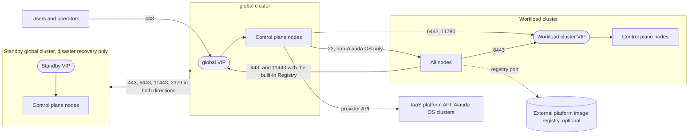

# Communication Matrix

This page is the single reference for the network access that <Term name="productShort" /> requires. Other pages link here instead of listing ports themselves. It has two parts:

- [Network Flows](#network_flows) are the connections that have to be allowed **between** machines and networks — through site firewalls, security groups, router ACLs, and load balancers. They apply to every cluster, whatever operating system its nodes run. Use them to request network and security approvals before you install the `global` cluster or create a workload cluster.
- [Node Ports](#node_ports) are the ports that platform components listen on **on each node**, which is what a host firewall on the node has to allow. This part differs between [non-Alauda OS nodes](#node_ports_non_alauda_os) and [Alauda OS nodes](#node_ports_alauda_os).

Every port on this page is TCP unless stated otherwise.

## Overview \{#overview}

The diagram shows the steady-state flows between the main parties. Flows that exist only during installation are listed in [Installation](#installation). The tables in [Network Flows](#network_flows) give the source, destination, port, and purpose of each flow.

_Diagram: Steady-state network flows between users, the `global` cluster, a standby `global` cluster, a workload cluster, an external registry, and an IaaS platform._

## Network Flows \{#network_flows}

### Platform Access \{#platform_access}

| Source | Destination | Port | Purpose |
| --- | --- | --- | --- |
| Users, operators, and external systems | Platform access address — the `global` VIP or the domain that resolves to it | `443`, or the custom HTTPS port set at installation | Web console, platform API, Kubernetes API, and image registry access over HTTPS |
| Users, operators, and external systems | Platform access address | `80` | Only when users access the platform over HTTP. The platform supports only HTTPS by default |

### Load Balancer Forwarding \{#lb_forwarding}

Configure each load balancer to forward the following ports from its VIP to **all control plane nodes** of its cluster. Traffic forwarded by a load balancer does not originate from a cluster node IP address, so allow it from the load balancer as well as from the cluster networks.

| Load balancer | Port | Required when | Purpose |
| --- | --- | --- | --- |
| `global` VIP, and the External IP if one is used | `443` | Always | Web console, image registry, and Kubernetes API over HTTPS. To use a custom HTTPS port, forward that port instead, and enter the same port in the installation parameters |
| `global` VIP, and the External IP if one is used | `6443` | Always | Kubernetes API server for the nodes of the cluster |
| `global` VIP, and the External IP if one is used | `11443` | The `global` cluster uses the platform built-in Registry | Image registry for the nodes. Not needed when you use an [external platform image registry](./external-platform-image-registry.mdx) |
| `global` VIP | `80` | Users access the platform over HTTP | Platform HTTP access |
| `global` VIP of both clusters of a disaster recovery pair | `2379` | Global disaster recovery, unless the standby reaches the active cluster's etcd directly through **Active Global Cluster ETCD Endpoints** | etcd synchronization. Only TCP (Layer 4) forwarding is supported; Layer 7 forwarding is not |
| Workload cluster VIP | `6443` | Always | Kubernetes API server of the workload cluster |
| Workload cluster VIP | `11780` | Always | Platform traffic from the `global` cluster to the workload cluster, for example for monitoring |

We recommend configuring health checks on the load balancer for each forwarded port.

On Huawei Cloud Stack, the HCS provider creates the `global` ELB listeners for clusters whose nodes run Alauda OS. See <ExternalSiteLink name="immutable-infra" href="/global/install.html" children="Installing the global Cluster" />.

### Self-built VIP \{#self_built_vip}

`Self-built VIP` replaces the external load balancer with keepalived running on the control plane nodes. Instead of a TCP or UDP port, it uses the VRRP protocol (IP protocol number `112`) and moves the VIP with gratuitous ARP.

- Allow VRRP between all control plane nodes that share the VIP, and allow gratuitous ARP updates on their subnet. `firewalld` and `ufw` block VRRP by default, so on a non-Alauda OS node with a host firewall the VIP never comes up unless you allow it.
- Place all control plane nodes and the VIP in the same subnet. The VIP must differ from every node IP address.
- No load balancer listeners are configured. The flows to the VIP listed on this page still apply.

Clusters whose nodes run a non-Alauda OS support `Self-built VIP`. Clusters whose nodes run Alauda OS support it from ACP 4.4, depending on the infrastructure provider; see <ExternalSiteLink name="immutable-infra" href="/how-to/control-plane-endpoint.html" children="Plan the Control Plane Endpoint" />.

### Within a Cluster \{#within_cluster}

| Source | Destination | Port | Purpose |
| --- | --- | --- | --- |
| All nodes of a cluster | The cluster's own VIP | `6443` | `kubelet` and cluster components reach the API server |
| All nodes of a cluster | Every other node of the same cluster | The ports in [Node Ports](#node_ports), plus Pod and Service traffic | Cluster-internal traffic. Pod and Service traffic must not be filtered by port; see [Allow Cluster-Internal Traffic](#cluster_internal_traffic) |

### Between the `global` Cluster and Workload Clusters \{#global_workload}

| Source | Destination | Port | Purpose |
| --- | --- | --- | --- |
| `global` cluster nodes | Workload cluster VIP | `6443` | The `global` cluster manages the workload cluster through its API server |
| `global` cluster nodes | Workload cluster VIP | `11780` | Platform traffic to the workload cluster, for example for monitoring |
| `global` cluster nodes | Workload cluster nodes | `22` | Non-Alauda OS only: the `global` cluster deploys the nodes over SSH. If the nodes cannot be reached over SSH directly, provide a SOCKS5 proxy; see [Creating an On-Premise Cluster](/configure/clusters/on-premises.mdx). Alauda OS nodes are provisioned from an image and do not need this flow |
| Workload cluster nodes | Platform access address | `443`, or the custom HTTPS port | Nodes and platform components reach the platform. If the workload cluster cannot reach the platform access address of the `global` cluster, add an address that it can reach, as described in [Creating an On-Premise Cluster](/configure/clusters/on-premises.mdx) |

### Image Registry \{#image_registry}

Allow the flows for the registry that each cluster uses.

| Registry | Source | Destination | Port |
| --- | --- | --- | --- |
| Platform built-in Registry, deployed with the `global` cluster | All nodes of every cluster that uses it, including the standby `global` cluster of a disaster recovery pair | `global` VIP or platform access address | `11443` |
| Platform built-in Registry through an external address | Workload cluster nodes that cannot reach the `global` cluster | The address configured in [Add External Address for Built-in Registry](/configure/clusters/how-to/add_external_addr_for_global_registry.mdx) | The port of that address |
| [External platform image registry](./external-platform-image-registry.mdx) | The installer node or bootstrap node, and all nodes of every cluster that uses it | The registry address | The port in the registry address, `<host-or-IP>[:port]` |
| **Private Repository** of a workload cluster | All nodes of that workload cluster | The registry address | The port in the registry address |
| Registry on the bootstrap node, Alauda OS installation only | `global` cluster nodes being provisioned | Bootstrap node | `11443`, until the `global` cluster's own registry takes over |

### Global Disaster Recovery \{#global_dr}

A disaster recovery pair needs the following flows. Allow them in **both directions** between the Primary and Standby cluster networks — on firewalls, security groups, router ACLs, and any other inter-site network controls — and forward them on both cluster VIPs as listed in [Load Balancer Forwarding](#lb_forwarding).

| Source | Destination | Port | Purpose |
| --- | --- | --- | --- |
| Standby cluster nodes | Platform access address, which resolves to the active cluster's VIP | `443` | **<Term name="product" /> etcd Synchronizer** reaches the active platform through this address, and logging and monitoring components send alert callbacks to it |
| Standby cluster nodes | Platform access address | `80` | Only when users access the platform over HTTP |
| Standby cluster nodes | Active cluster VIP | `6443` | While **<Term name="product" /> etcd Synchronizer** is installed or reinstalled, the standby obtains the etcd CA material from the active cluster's API server |
| Standby cluster nodes | Platform access address | `11443` | The standby pulls platform and plugin images from the platform built-in Registry |
| Standby cluster nodes | Active cluster VIP, or the addresses set in **Active Global Cluster ETCD Endpoints** | `2379` | **<Term name="product" /> etcd Synchronizer** reads etcd data from the active cluster and writes it to the local etcd. TCP forwarding only |

The rules must be bidirectional because the cluster roles are reversed after a failover: the former Primary becomes the new Standby and has to reach the new Primary on the same ports. This does not make etcd replication bidirectional — **<Term name="product" /> etcd Synchronizer** runs only on the current Standby Cluster and writes to its local etcd.

For the procedure, see [Global Disaster Recovery](../global_dr.mdx). For a `global` cluster whose nodes run Alauda OS, see <ExternalSiteLink name="immutable-infra" href="/global/disaster_recovery.html" children="Global Cluster Disaster Recovery" />.

### Installation \{#installation}

These flows are needed only while the `global` cluster is being installed.

**Non-Alauda OS.** `setup.sh` runs on a node that becomes a control plane node of the `global` cluster.

| Source | Destination | Port | Purpose |
| --- | --- | --- | --- |
| Operators | Installer node | `8080` | Web console of the installer |
| Installer node | All other `global` cluster nodes | The ports in [Platform Ports](#platform_ports), including `22` | The installer deploys the nodes |

**Alauda OS.** `setup.sh` runs on a temporary bootstrap node that never joins the `global` cluster. In a disaster recovery deployment, each side is installed from its own bootstrap node, so allow these flows for both bootstrap nodes.

| Source | Destination | Port | Purpose |
| --- | --- | --- | --- |
| Operators | Bootstrap node | `22` | Run the installation |
| Bootstrap node | IaaS platform API | See [Infrastructure Providers](#infrastructure_providers) | The Cluster API providers run on the bootstrap node during installation and create the `global` cluster machines |
| Bootstrap node | `global` VIP | `6443` | Cluster API reaches the control plane endpoint while the control plane is created |
| `global` cluster nodes being provisioned | Bootstrap node | `11443` | Nodes pull the platform images from the bootstrap node until the `global` cluster's own registry takes over |
| `global` cluster hosts, Bare Metal only | Bootstrap node | `12443` | Elemental registration endpoint used during the bootstrap phase |

For the bootstrap node requirements, see <ExternalSiteLink name="immutable-infra" href="/global/install.html" children="Installing the global Cluster" />.

### Infrastructure Providers \{#infrastructure_providers}

Clusters whose nodes run Alauda OS are created through a Cluster API infrastructure provider. The provider runs on the bootstrap node while the `global` cluster is installed and on the `global` cluster afterwards, so allow these flows from the bootstrap node and from the `global` cluster nodes.

| Provider | Destination | Port | Purpose |
| --- | --- | --- | --- |
| Huawei DCS | DCS VRM virtual IP | `7443` | DCS REST API: cluster lifecycle calls and the first step of a file upload (`applyUpload`) |
| Huawei DCS | Management IP address of every DCS physical host that may receive a clone | The port returned by DCS, typically `8443`. Confirm it with the DCS administrator | Upload of the Ignition ISO to the URL returned by `applyUpload` |
| Huawei Cloud Stack | HCS API and IAM endpoints | The port of each endpoint | Resource lifecycle through the HCS API |
| VMware vSphere | vCenter | `443` | Machine lifecycle through the vSphere API |

If the `global` cluster nodes have several network interfaces, make sure that each destination is routable from the interface that reaches it.

**Bare Metal.** Hosts are registered, installed, and joined over the network, so open these flows before the first host boots the `SeedImage` ISO:

| Stage | Source | Destination | Port | Purpose |
| --- | --- | --- | --- | --- |
| First boot | Each host booted from the `SeedImage` ISO | Platform access address | `443`, or the custom HTTPS port | `elemental-register` registers the host and creates its `MachineInventory` |
| First boot and every reprovision | Each host | Platform registry | `11443` | `elemental install` and `elemental upgrade` pull the Alauda OS image |
| Provisioning and steady state | Each workload cluster host | Platform access address, path `/kubernetes/global` | `443`, or the custom HTTPS port | `elemental-system-agent` polls its plan Secret through the platform ingress, not through a direct connection to an API server |
| Steady state | Each `global` cluster host after handoff | The VIP of its own `global` cluster | `6443` | The system agent of a `global` host uses the local API server |

A Bare Metal host also needs DNS, NTP, the registry, its cluster's control plane endpoint, and cluster-internal traffic, as listed in the other sections of this page. A firewall approval that covers only `443` produces hosts that register successfully and then fail during installation or join.

### Infrastructure Services \{#infrastructure_services}

| Source | Destination | Port | Purpose |
| --- | --- | --- | --- |
| All nodes, and the installer node or bootstrap node | DNS servers | `53`, UDP and TCP | Name resolution of the platform access address, the registry, and other endpoints |
| All nodes | NTP servers | `123`, UDP | Time synchronization. A production cluster should not depend on public NTP servers |
| Platform alerting components | The notification endpoints you configure, such as a mail server or a webhook receiver | The port of each endpoint | Alert delivery |

### What This Matrix Does Not Cover \{#not_covered}

Check each of the following against your own deployment. A requirement that applies to your cluster but is not listed here still has to be allowed.

- **Pod and Service traffic.** See [Allow Cluster-Internal Traffic](#cluster_internal_traffic).
- **Secondary and non-default container networks.** The `6081/UDP` port in [Node Ports](#node_ports) is used by the default Kube-OVN Geneve tunnel. If you change the Kube-OVN tunnel type, or attach a secondary network with Multus on top of the default one, those networks carry Pod traffic between node IP addresses using their own encapsulation, which is not listed here. Confirm what your configuration uses and allow it between the nodes.
- **Application traffic.** Ports exposed by your applications through an ingress controller, a gateway, or `NodePort` and `LoadBalancer` Services are defined by those applications.
- **Agnostic extensions.** Ports required by Agnostic extensions are maintained by those extensions.

## Node Ports \{#node_ports}

This part lists the ports that <Term name="productShort" /> core components and Aligned extensions listen on. Some of the components run only on `global` cluster nodes; a workload cluster node listens on the subset of these ports that applies to the components it runs.

### Allow Cluster-Internal Traffic \{#cluster_internal_traffic}

<Directive type="danger" title="Allow Cluster-Internal Traffic Before You Apply Firewall Rules">
The node port lists are not a complete firewall rule set. Pod-to-Pod and Pod-to-Service traffic uses arbitrary ports, so a host firewall that allows only the listed ports breaks cluster networking.

When a host firewall is enabled, also treat the Pod CIDR, the Service CIDR, and the network interfaces created by the CNI plugin as trusted sources, so that cluster-internal traffic is not filtered by port. The interface names depend on the CNI plugin and on the environment, so read them from the node instead of assuming a fixed name.
</Directive>

### Non-Alauda OS Nodes \{#node_ports_non_alauda_os}

You need this section only when a host firewall, such as `firewalld` or `ufw`, is enabled on the cluster nodes. Keeping the host firewall disabled is the default and recommended node configuration. Before you enable a host firewall, read [Hardened Node Security Configuration](./node_preprocessing.mdx#hardened_node_security), which gives the `init.sh` arguments and the order in which to apply the configuration.

This section is not the same as the port occupancy check in [Node Preprocessing](./node_preprocessing.mdx#node_checks). That check confirms that no other process has already bound the ports the platform needs before the installation starts. This section describes which ports a host firewall must allow. Both apply when a host firewall is enabled.

#### Platform Ports \{#platform_ports}

| Port | Protocol | Component |
| --- | --- | --- |
| `22` | TCP | `sshd` |
| `80` | TCP | `alb2` |
| `443` | TCP | `global-alb2` |
| `1936` | TCP | `alb2` |
| `2049` | TCP | `nfs` |
| `2379` | TCP | `etcd` |
| `2380` | TCP | `etcd` |
| `6081` | UDP | `kube-ovn` |
| `6443` | TCP | `kube-apiserver` |
| `6641` | TCP | `ovsdb-server` |
| `6642` | TCP | `ovsdb-server` |
| `6643` | TCP | `ovsdb-server` |
| `6644` | TCP | `ovsdb-server` |
| `7473` | TCP | `frr-metrics` |
| `9000` | TCP | `minio` |
| `9100` | TCP | `node_exporter` |
| `10250` | TCP | `kubelet` |
| `10257` | TCP | `kube-controller-manager` |
| `10259` | TCP | `kube-scheduler` |
| `10660` | TCP | `kube-ovn-controller` |
| `10661` | TCP | `kube-ovn-monitor` |
| `10665` | TCP | `kube-ovn-daemon` |
| `11443` | TCP | `registry` |
| `11780` | TCP | `global-alb2` |
| `11782` | TCP | `global-alb2` |
| `17472` | TCP | `speaker` |
| `17946` | TCP | `speaker` |
| `30000-32767` | TCP | User application `NodePort` range |
| `30000-32767` | UDP | User application `NodePort` range |

- Every port in the table has to be reachable between the cluster nodes and from the node that runs the installer.
- `443/tcp` additionally carries the platform access address, so it has to be reachable by the users and systems that access the platform.
- `30000-32767` is the port range reserved for `NodePort` Services created by user applications. A port in this range is opened on the nodes when an application that uses it is deployed, and it is closed again when the corresponding Service is deleted. Allow this range on the host firewall only if your applications use `NodePort` Services, and restrict it to the sources those applications are meant to serve.

#### Installer Node Ports \{#installer_node_ports}

The node that runs the installer also uses `8080`, `12080`, `12443`, and `16443`. Allow these ports on that node before you start the installation.

#### Calico Ports \{#calico_ports}

The following ports are required only when the cluster uses the Calico CNI plugin.

| Port | Protocol | Component |
| --- | --- | --- |
| `179` | TCP | `calico-node`, BGP |
| `9091` | TCP | `calico-node` |
| `9324` | TCP | `bird_exporter` |

#### VRRP for `Self-built VIP`

When the cluster uses `Self-built VIP`, allow the VRRP protocol between the control plane nodes that share the VIP. See [Self-built VIP](#self_built_vip).

### Alauda OS Nodes \{#node_ports_alauda_os}

The Alauda OS image preconfigures the node host firewall (`firewalld`), and the platform maintains it. You do not manage these rules. To open an additional port — for example, for a workload that listens directly on the node — use a MachineConfig as described in <ExternalSiteLink name="immutable-infra" href="/machine-configuration/firewall.html" children="Managing Firewall Ports" />.

The preconfigured rules allow the following:

| Type | Allowed |
| --- | --- |
| TCP ports | `22`, `53`, `80`, `179`, `443`, `1936`, `2181`, `2379`, `2380`, `2888`, `3300`, `3306`, `3888`, `5671`, `5672`, `6032`, `6042`, `6443`, `6641-6646`, `6789`, `6800-7300`, `7473`, `7480`, `8080`, `9000`, `9091`, `9092`, `9094`, `9100`, `9104`, `9121`, `9141`, `9200`, `9253`, `9283`, `9300`, `9308`, `9323`, `9353`, `9404`, `9926`, `10249`, `10250`, `10257`, `10259`, `10660`, `10661`, `10665`, `11443`, `11780`, `11781`, `11782`, `15012`, `15017`, `15021`, `15443`, `15671`, `15672`, `16379`, `17472`, `17946`, `26379`, `27017`, `30000-32767`, `33062` |
| UDP ports | `53`, `6081`, `30000-32767` |
| Protocols | ICMP, VRRP |
| Other | IP masquerading |

Compared with the [non-Alauda OS lists](#node_ports_non_alauda_os):

- Every port in [Platform Ports](#platform_ports) is preconfigured except `2049/TCP` (`nfs`).
- Of the [Calico Ports](#calico_ports), `179` and `9091` are preconfigured; `9324` is not.
- VRRP is allowed, so `Self-built VIP` needs no additional node rule.
- The list covers <Term name="productShort" /> core components and Aligned extensions, so it also includes ports beyond the platform ports, such as those of service mesh, storage, and data services.

Ports required by Agnostic extensions and other third-party components are not preconfigured. If your cluster needs a port that is not preconfigured, open it with a MachineConfig.
