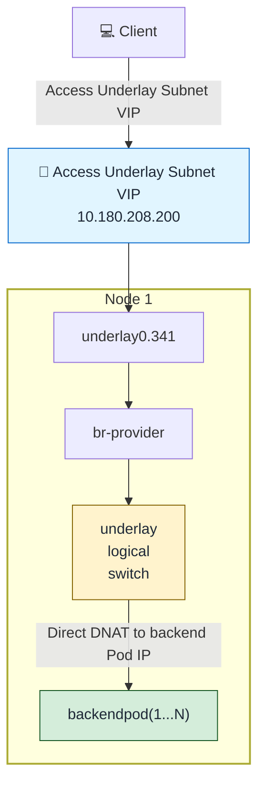

# Kube-OVN Underlay + MetalLB LoadBalancer Service Configuration

## Overview

This solution addresses the integration of MetalLB L2 mode with Kube-OVN Underlay networking. It allows users to utilize Underlay subnet IPs as MetalLB LoadBalancer Service VIPs, directly forwarding traffic to backend business Pods.

> ⚠️ **Critical**: The LoadBalancer VIP and the backend Pod IPs **must be in the same Underlay subnet**.

## Prerequisites

### Environment Requirements
- **ACP version**: >= 4.2.2
- **IP support**: IPv4 only (IPv6 is currently not supported)

### Traffic Flow

**Traffic Diagram**:


---

## Configuration Steps

### 1. Configure ProviderNetwork with VLAN Sub-interfaces

**Important**: VLAN sub-interfaces must be used.

Configure Kube-OVN Underlay network to automatically create VLAN sub-interfaces:
```yaml
apiVersion: kubeovn.io/v1
kind: ProviderNetwork
metadata:
  name: provider
spec:
  defaultInterface: underlay0.341
  autoCreateVlanSubinterfaces: true  # Automatically creates VLAN sub-interfaces (e.g., underlay0.341) if only parent interface (underlay0) exists
  # If customInterfaces are used, each interface MUST also be the VLAN sub-interface
  # (parent interface name + VLAN suffix, e.g., underlay0.341), not the parent interface
  # customInterfaces:
  #   - interface: underlay0.341
  #     nodes:
  #       - node1

---
apiVersion: kubeovn.io/v1
kind: Vlan
metadata:
  name: ovn-vlan
spec:
  id: 0    # Use 0 because autoCreateVlanSubinterfaces creates the VLAN sub-interface (underlay0.341) which handles VLAN tagging, not Kube-OVN directly
  provider: provider
status:
  subnets:
  - ovn-default
```

> ⚠️ **Important**: If the `ProviderNetwork` specifies per-node interfaces via `customInterfaces`, each `customInterfaces[].interface` **must also use the VLAN sub-interface** (parent interface name + VLAN suffix, e.g., `underlay0.341`), not the parent interface (e.g., `underlay0`). Leaving a parent interface in `customInterfaces` prevents MetalLB LoadBalancer traffic from reaching the backend Pods.

> ⚠️ **Warning**: When modifying the `ProviderNetwork` or `Vlan` resources individually, the Underlay network connectivity will be interrupted. Network connectivity will only be restored after both resources are fully configured and in sync. Plan configuration changes during maintenance windows to minimize service disruption.

### 2. Configure Kube-OVN Controller Parameters

Configure the Kube-OVN controller with the required parameters for LoadBalancer functionality:

**Using Web Console:**
1. Navigate to **Administrator** > **Marketplace** > **Cluster Plugins**, then search for `ovn` to locate **Alauda Container Platform Networking**
2. In the plugin row, click the action menu (vertical ⋮) and select **Update** to open the configuration dialog
3. Configure the following settings:
   - **Skip CT for Dst LPort IPs**: **No**
   - **Enable OVN LB Local**: **Yes**

### 3. Configure Underlay Subnet External Address Feature

Edit the Underlay subnet to reserve an IP range for LoadBalancer usage:

> **Important**: External address pool IPs must be within the Underlay subnet.

Set `spec.enableExternalLBAddress: true`. If U2O is enabled on this subnet, also enable **Overlay Route Only** by setting `spec.u2oFeatures.overlayOnlyRouting: true` together with `spec.u2oInterconnection: true`. Enable **Overlay Route Only** on every participating Underlay subnet that has U2O enabled, including client subnets. The networking plugin must support this option.

The following example reserves the LoadBalancer VIP range and enables U2O with **Overlay Route Only**. Merge these fields into the existing subnet configuration, preserving its other settings and existing reserved IPs:
```yaml
apiVersion: kubeovn.io/v1
kind: Subnet
metadata:
  name: underlay-subnet
spec:
  enableExternalLBAddress: true       # Indicates this subnet has IP range for LB service VIP
  u2oInterconnection: true
  u2oFeatures:
    overlayOnlyRouting: true
  excludeIps:
  - 10.180.208.200..10.180.208.220    # Reserve IP range for external address pool
```

With **Overlay Route Only** enabled, traffic from an Underlay Pod to other Underlay subnets or external networks uses the physical gateway, including return traffic to LoadBalancer clients in those networks. Clients in the same Underlay subnet use the local network. Communication with Overlay subnets in the same VPC continues to use OVN, and the Pod's default gateway remains the U2O interconnection gateway. U2O is not required for MetalLB access from the physical network; the two U2O settings above apply when U2O is enabled. For details, see [Automatic Interconnection of Underlay and Overlay Subnets](./underlay_overlay_st.mdx).

### 4. Create MetalLB External Address Pool

```yaml
# underlay-ippool.yaml
apiVersion: metallb.io/v1beta1
kind: IPAddressPool
metadata:
  name: acp-underlay-pool
  namespace: metallb-system
spec:
  addresses:
    - 10.180.208.200-10.180.208.220  # Underlay subnet IP range
  avoidBuggyIPs: true
  autoAssign: true
---
apiVersion: metallb.io/v1beta1
kind: L2Advertisement
metadata:
  name: acp-underlay-pool
  namespace: metallb-system
spec:
  ipAddressPools:
    - acp-underlay-pool
  interfaces:
    - br-provider  # Optional: Interface for ARP broadcasting; use bridge interface (br-*) instead of physical interface
  nodeSelectors: []
```

Deploy the address pool:
```shell
kubectl apply -f underlay-ippool.yaml
```

### 5. Create Sample Application and LoadBalancer Service

```yaml
# application-with-loadbalancer.yaml
apiVersion: apps/v1
kind: Deployment
metadata:
  name: backend-app
  labels:
    app: backend
spec:
  replicas: 3
  selector:
    matchLabels:
      app: backend
  template:
    metadata:
      labels:
        app: backend
    spec:
      containers:
        - name: backend
          image: nginx:1.25
          ports:
            - containerPort: 80
---
apiVersion: v1
kind: Service
metadata:
  name: backend-lb-service
  # To use specific IPPool: add annotation `metallb.io/address-pool: acp-underlay-pool`
  # To use fixed IP: set `spec.loadBalancerIP: 10.180.208.201`
spec:
  type: LoadBalancer
  externalTrafficPolicy: Local  # **IMPORTANT**: Required for preserving source IP and enabling direct Pod routing
  selector:
    app: backend
  ports:
    - port: 80
      targetPort: 80
```

Deploy the application:
```shell
kubectl apply -f application-with-loadbalancer.yaml
```

### 6. Verify Configuration

```bash
# Check service status
kubectl get svc backend-lb-service -o wide

# Test external access
curl http://10.180.208.200
```

### 7. Migrating Existing Services

For existing services using the old address pool (node subnet only), you can migrate them to the new Underlay address pool:

```bash
# Add annotation to migrate existing service
kubectl annotate service <existing-service-name> metallb.io/address-pool=acp-underlay-pool --overwrite

# Verify the service has been assigned a new IP from the Underlay pool
kubectl get svc <existing-service-name> -o wide
```

For **new services**, add the annotation directly:

```yaml
apiVersion: v1
kind: Service
metadata:
  name: backend-lb-service
  annotations:
    metallb.io/address-pool: acp-underlay-pool  # Use the Underlay address pool
spec:
  type: LoadBalancer
  externalTrafficPolicy: Local
  selector:
    app: backend
  ports:
    - port: 80
      targetPort: 80
```

```bash
# Check service status
kubectl get svc backend-lb-service -o wide

# Test external access
curl http://10.180.208.200
```

## Trademark Notice

NGINX® is a registered trademark of F5, Inc. in the U.S. and in other countries.

MetalLB™ is a trademark of The Linux Foundation.

Alauda is an independent vendor. This product is not affiliated with, endorsed by, or sponsored by The Linux Foundation or F5, Inc. All trademarks are the property of their respective owners and are used here for identification purposes only.
