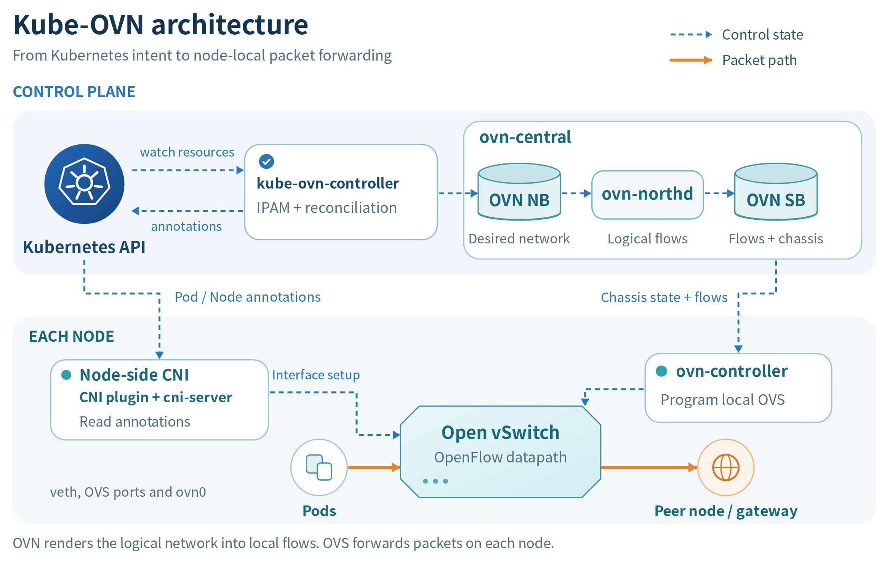
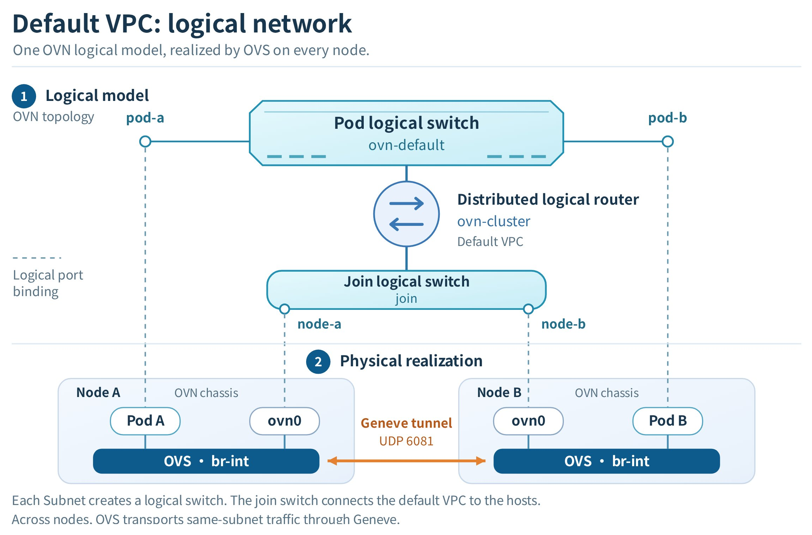
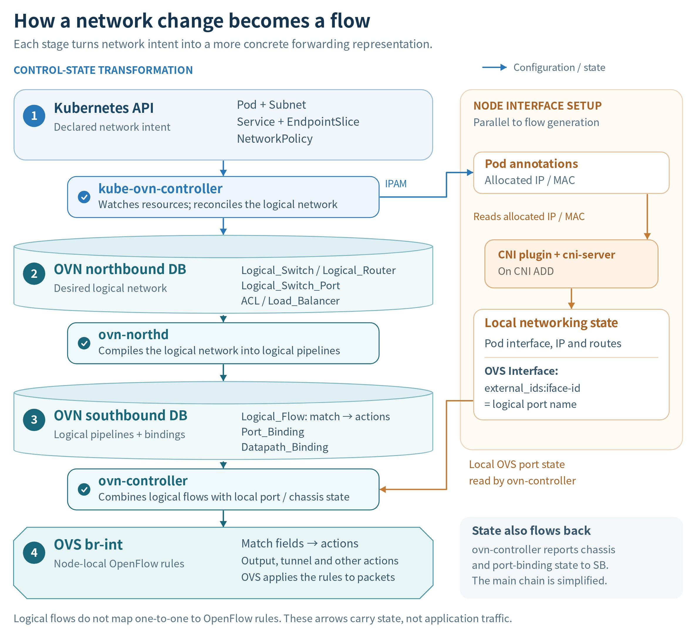
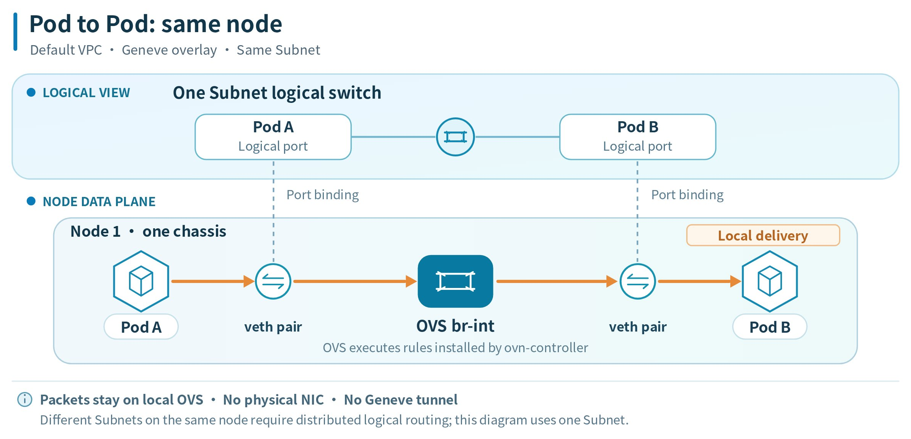
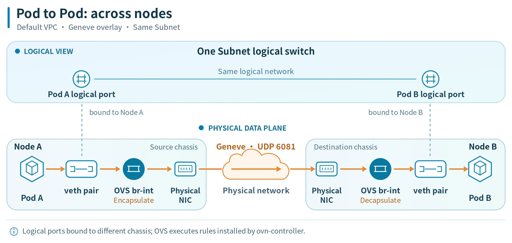
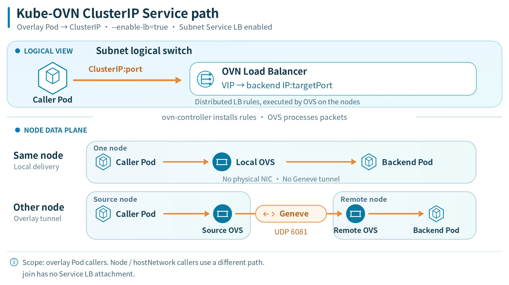
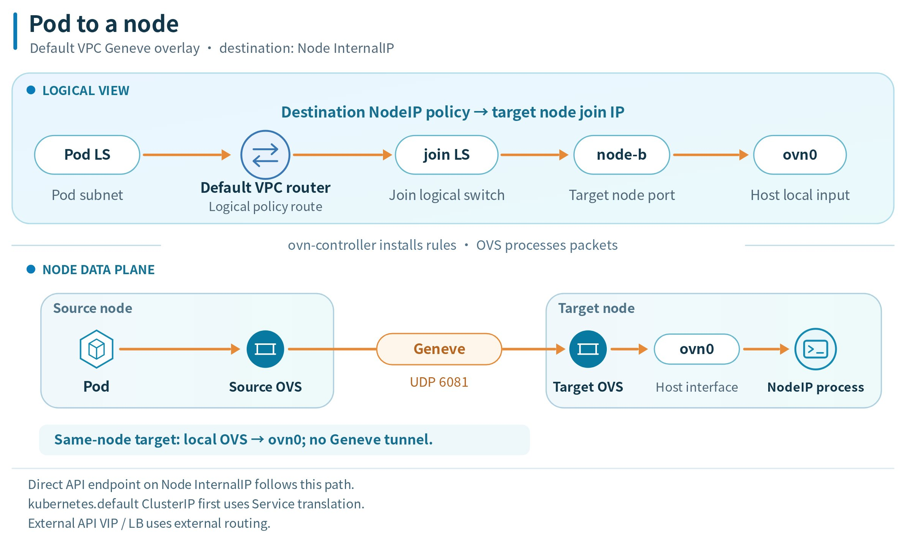
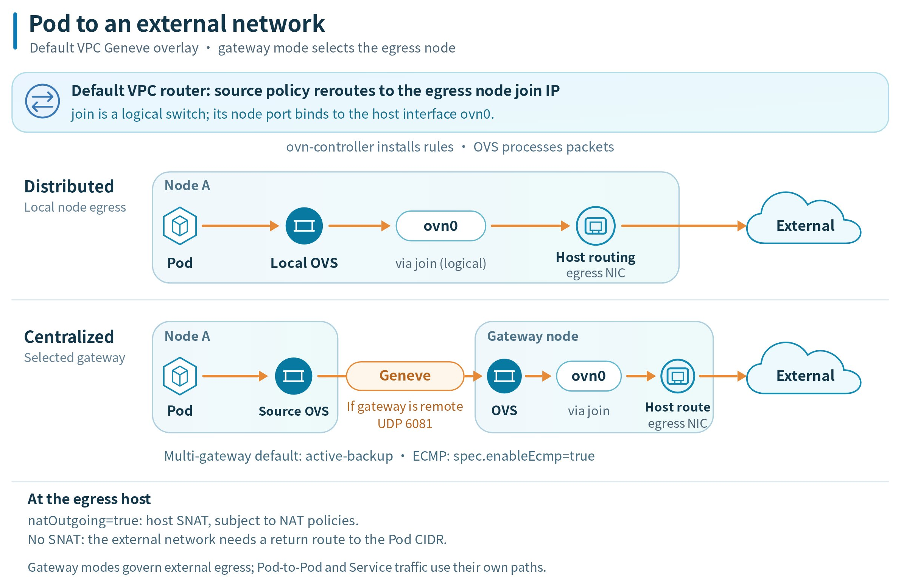

# Understanding Kube-OVN CNI

Kube-OVN connects Kubernetes Pods using Open Virtual Network (OVN) and Open vSwitch (OVS). It allocates Pod addresses, builds logical networks, and implements network policies and Service load balancing.

This page explains Kube-OVN architecture, logical networks, configuration updates, and common traffic paths. It also provides component inspection examples and links to configuration guides.

## Network Modes and Scope \{#network-modes-and-scope}

Kube-OVN supports overlay and underlay Subnets. The mode determines how Pod traffic reaches other nodes and the physical network.

| Network mode | How it connects Pods | What to plan |
| --- | --- | --- |
| Overlay | OVS transports cross-node Pod traffic over the node network using a tunnel. The default tunnel type is Geneve. | Pod CIDRs, node-to-node connectivity, tunnel traffic, and the MTU. |
| Underlay | A Subnet connects to the physical network through a VLAN and a ProviderNetwork (bridge network). Traffic on that physical network does not use the overlay tunnel. | Physical IP allocation, node interfaces, VLAN connectivity, and the physical gateway. See [Prepare the underlay physical network](./kubeovn_underlay_py.mdx). |

The traffic-path diagrams in this page describe an overlay network in the default VPC with Geneve tunnels. The Service diagram also assumes that OVN Service load balancing is enabled for the controller and the source Subnet. Names and CIDRs shown as defaults can differ from your cluster configuration; check the Subnet settings and the installed Kube-OVN configuration with your administrator.

## Architecture and Components \{#architecture-overview}

The control plane maintains the desired network and translates it into forwarding rules. Node components connect Pod interfaces and realize those rules in OVS. Monitoring and optional components provide health information and external integration.



### Control plane components

#### kube-ovn-controller

The `kube-ovn-controller` Deployment watches network-related Kubernetes resources, including Pods, [Services](../../functions/configure_service.mdx), EndpointSlices, Nodes, [NetworkPolicies](/networking/security/network_policy.mdx), VPCs, [Subnets](../../functions/configure_subnet.mdx), [VLANs](../../functions/configure_subnet.mdx#add-vlan-by-using-the-web-console-optional), and [ProviderNetworks](../../functions/configure_subnet.mdx#add-bridge-network-by-using-the-cli).

It allocates Pod addresses, writes logical ports and the required routes or policies to the OVN northbound database, and records assigned network information in Pod annotations for the node agent.

#### ovn-central

The `ovn-central` Deployment runs the OVN control plane services in its `ovn-central` container:

- `ovn-nb`: The northbound database stores the desired logical network, including switches, routers, ports, ACLs, and load balancers.
- `ovn-sb`: The southbound database stores logical flows, datapath and port bindings, and chassis state.
- `ovn-northd`: Translates northbound configuration into the logical flows and related records used in the southbound database.

For upstream implementation details, see the [OVN architecture](https://www.ovn.org/support/dist-docs/ovn-architecture.7.html). For the effects of component failures, see [High availability](#high-availability).

### Node components

#### ovs-ovn

The `ovs-ovn` DaemonSet runs an `openvswitch` container on each eligible Linux node. The container includes the local OVS database, `ovn-controller`, and `ovs-vswitchd`. The OVS database holds bridge and interface configuration, `ovn-controller` programs the forwarding rules, and `ovs-vswitchd` manages packet forwarding through the OVS datapath.

#### kube-ovn-cni

The `kube-ovn-cni` DaemonSet runs a `cni-server` container on each eligible Linux node. Its `install-cni` init container installs the `kube-ovn` CNI plugin and supporting binaries into the host's CNI binary directory (`/opt/cni/bin` by default), and writes the CNI configuration to `/etc/cni/net.d` by default. The container runtime invokes the `kube-ovn` plugin, which sends CNI requests to the local `cni-server`.

The node-side CNI plugin and `cni-server` work together to:

- Configure Pod interfaces, IP addresses, and routes during CNI ADD, and remove the corresponding attachments during CNI DEL.
- Attach Pod interfaces to OVS ports and maintain their local network configuration.

The `cni-server` daemon also maintains node networking by:

- Continuously reconciling host gateway filtering, NAT, and routing rules.
- Creating and configuring `ovn0` to connect the host network to the default VPC.

Additional node-network configuration has its own requirements. See [Prepare the underlay physical network](./kubeovn_underlay_py.mdx) and [Cluster Interconnection (Alpha)](./configure_ovn_interconnection.mdx).

### Monitoring and optional components \{#monitoring-operation-and-maintenance-tools-and-extension-components}

#### kube-ovn-pinger

The `kube-ovn-pinger` DaemonSet runs a `pinger` container on each eligible Linux node to collect OVS status information and probe network connectivity and latency.

#### kube-ovn-monitor

The `kube-ovn-monitor` Deployment collects OVN status information and metrics. In the standard deployment, it runs on a node selected for OVN central services.

#### kube-ovn-speaker

This optional DaemonSet runs on nodes selected for BGP advertisement and publishes routes to the external network, allowing external access directly through Pod IPs. For installation and BGP options, see [Configure BGP](./configure_bgp.mdx).

### Component deployment \{#component-deployment-and-discovery}

The following table describes a standard ACP installation with the OVN control plane in the same cluster. The Kubernetes workloads use the `kube-system` namespace by default. If your installation uses another namespace or a separately hosted OVN control plane, use its actual namespace and workload configuration.

| Component | Kubernetes workload | Deployment location | Main container |
| --- | --- | --- | --- |
| `ovn-central` | Deployment | Nodes selected for OVN central services, with `kube-ovn/role=master` by default. | `ovn-central` |
| `kube-ovn-controller` | Deployment | Eligible Linux nodes selected by the scheduler; replicas are spread across nodes. It is not restricted to control-plane nodes by default. | `kube-ovn-controller` |
| `ovs-ovn` | DaemonSet | Each eligible Linux node. | `openvswitch` |
| `kube-ovn-cni` | DaemonSet | Each eligible Linux node. | `cni-server` |
| `kube-ovn-pinger` | DaemonSet | Each eligible Linux node. | `pinger` |
| `kube-ovn-monitor` | Deployment | A node selected for OVN central services, with `kube-ovn/role=master` by default. | `kube-ovn-monitor` |
| `kube-ovn-speaker` (optional) | DaemonSet | Nodes selected for BGP advertisement, with `ovn.kubernetes.io/bgp=true` in the example manifest. | `kube-ovn-speaker` |
| `kubectl-ko` | Kubectl plugin | The administrator's workstation or another host with cluster access. | Not applicable |

Node selectors, affinity, and tolerations determine which nodes are eligible. Deployment replica counts depend on the installation; a DaemonSet places a Pod on each eligible node. The optional speaker is installed separately as described in [Configure BGP](./configure_bgp.mdx).

For commands and actual example outputs, see [Inspecting components in your cluster](#inspecting-components-in-your-cluster).

## Logical Network

OVN models the cluster network as logical switches and logical routers, and Kube-OVN maps its Kubernetes resources onto them. A VPC groups Subnets under its logical routing configuration. The following diagram shows the default VPC, including the `join` switch that connects it to the hosts. Custom VPCs have their own logical routers and require their own routing and external connectivity configuration. For resource fields, see the [VPC API reference](/apis/kubernetes_apis/networking/vpc.mdx).



In this default VPC overlay network, Pods attach to their Subnet's logical switch, the Subnet gateway connects that switch to the VPC logical router, and `join` connects the router to the nodes' `ovn0` ports. OVS implements the logical switching and routing on the nodes. Cross-node overlay traffic uses tunnels; traffic destined for a host or an external network leaves the overlay through the appropriate node interface. The sections below describe each part.

### Logical switches and subnets

Each OVN-managed [Subnet](../../functions/configure_subnet.mdx#kube-ovn_overlay_network) is backed by one logical switch. Pods attached to the Subnet become logical switch ports. A Namespace can have its own Subnet or share one with other Namespaces.

`kube-ovn-controller` allocates Pod IP addresses from the selected Subnet. The MAC address can be specified for the Pod or generated by IPAM. The controller records the assigned IP and MAC addresses, along with the Subnet CIDR, gateway, and logical switch, in Pod annotations. The node-side CNI components use this information, together with any additional route configuration, to configure the Pod interface and routes.

The default Subnet `ovn-default` carries the Pod network in a standard default VPC deployment. Custom VPCs have their own logical routers and Subnets. Attaching multiple interfaces to one Pod is a separate configuration described in [Pod multi-network interfaces](./multiple_networks.mdx).

### IP address allocation and Subnet selection

Kube-OVN allocates an address from the Subnet selected for each Pod interface it manages. For the primary network, the platform's project or Namespace binding determines the available Subnets unless the Pod explicitly selects a Subnet. Without an explicit selection or binding, Pods use their VPC's default Subnet. For the platform allocation rules, see [Configure Subnets](../../functions/configure_subnet.mdx).

When planning addresses, consider the following:

- **Available addresses:** The Subnet CIDR defines the address range. Reserved addresses in `excludeIps` are excluded from automatic allocation; reserving an address does not assign it to a Pod.
- **IP pools:** An [IPPool](./configure_ippool.mdx) restricts allocation to a set of addresses within a Subnet. Namespace or Pod settings select the pool. Running out of addresses in the eligible pools does not mean the Pod can use the remaining addresses elsewhere in the Subnet.
- **Address exhaustion:** If no eligible address is available, Pod network setup cannot complete. Check the Pod events and the available addresses in its selected Subnet or IPPool.
- **Pod replacement:** A replacement Pod is not guaranteed to receive the previous Pod's address through automatic allocation. Use a [Service](../../functions/configure_service.mdx) when applications need a stable access address.

Choose CIDRs and address families that match the cluster configuration. Check for conflicts with the node network, Service CIDRs, `join`, and external networks that the Pods must reach. For a secondary Pod interface, follow the separate Subnet and network attachment configuration in [Pod multi-network interfaces](./multiple_networks.mdx).

### The join switch and the node interface

Nodes are not part of a Pod Subnet. Kube-OVN connects each node to the overlay through a dedicated logical switch named `join` (CIDR `100.64.0.0/16` by default) and an OVS internal port named `ovn0` on the node.

`ovn0` connects the host network to the default VPC. `kube-ovn-controller` allocates the node an address from the `join` Subnet and records it in Node annotations; `kube-ovn-cni` reads those annotations to create and configure the interface. The [Pod-to-node path](#pod-to-a-node-or-an-api-server) below explains how traffic reaches a node or an API server endpoint on that node.

### Overlay encapsulation

With the default Geneve network, OVS instances on different nodes are connected by tunnels. `ovn-controller` installs the forwarding rules, and OVS encapsulates cross-node overlay traffic in Geneve (UDP 6081) and sends it to the remote node's encapsulation address. The node network must allow this traffic between the participating nodes. See [Configure the MTU](./configure_mtu.mdx) for the encapsulation overhead this adds.

For underlay traffic, a [VLAN Subnet](../../functions/configure_subnet.mdx#kube_ovn_underlay_network) connects to the physical network through a `localnet` port and the ProviderNetwork's node interfaces. Connectivity between underlay and overlay Subnets needs the appropriate routing configuration; see [Automatic interconnection of underlay and overlay Subnets](./underlay_overlay_st.mdx).

### Gateway modes \{#gateway-modes}

For an overlay Subnet in the default VPC, `gatewayType` selects the nodes used for external egress. For Subnets in this VPC other than `join`, the controller sets an omitted `gatewayType` to `distributed`.

The logical router uses policy routes to direct that traffic to the selected node's address on the `join` switch:

- **Distributed**: each node acts as the gateway for the Pods running on it, so north-south traffic exits through the local node.
- **Centralized**: external egress is directed to selected gateway nodes. Multiple gateway nodes use active-backup mode by default; ECMP requires `spec.enableEcmp: true`.

These modes govern external egress; traffic between Pods or to a Service is not automatically sent through a centralized gateway. See the [external access paths](#pod-to-an-external-network) below and [Configure a centralized gateway](./configure_centralized_gateway.mdx).

### Network isolation and access control

A Namespace or Subnet assignment determines where workloads belong and how they receive addresses. It does not, by itself, deny traffic to workloads in other Namespaces or Subnets. Subnets in the same VPC can communicate through its logical router when routes and access-control rules allow it.

Use the following controls for their respective purposes:

| Control | Purpose |
| --- | --- |
| VPC | Groups Subnets under a separate logical routing configuration. Consider any configured routes, gateways, physical networks, and additional Pod interfaces when defining isolation between VPCs. |
| NetworkPolicy | Selects Pods and controls their ingress or egress traffic. Policies can use Pod and Namespace selectors or IP ranges. |
| Subnet isolation and ACLs | Apply access-control rules at the Subnet's logical network. Check these rules as well as NetworkPolicy when diagnosing connectivity. |

For standard NetworkPolicy, ingress and egress isolation are evaluated separately. When a direction is isolated, the traffic must be allowed by a policy selecting the Pod in that direction; a connection must satisfy the applicable rules at both ends. If cluster-wide policies or Subnet ACLs are configured, their actions and evaluation order also affect the result. See [Network Policy](../../security/network_policy.mdx) and [Network Policy APIs](../../security/understanding_network_policy.mdx).

Pods using `hostNetwork` share the node network and do not have an ordinary Pod network interface on the Subnet. Do not use ordinary Pod NetworkPolicy assumptions to describe their isolation; check the node's access controls and the [documented policy limitations](../../security/network_policy.mdx).

## How a Network Change Becomes a Flow

Kubernetes resources describe the desired network. Kube-OVN and OVN translate that configuration into progressively more detailed representations until each node has the OpenFlow rules needed to forward packets.



The arrows show configuration and state updates. Packet forwarding takes place in OVS on the nodes.

1. **Kubernetes resources to logical network objects.** `kube-ovn-controller` watches resources such as Pods, Subnets, Services, and NetworkPolicies. It reconciles them into the OVN northbound database (`ovn-nb`): logical switches, routers, ports, ACLs, and load balancers describe the intended connectivity.
2. **Logical network objects to logical flows.** `ovn-northd` reads the northbound configuration and builds the logical processing pipeline in the OVN southbound database (`ovn-sb`). `Logical_Flow` records describe match conditions and actions; `Datapath_Binding` and `Port_Binding` records identify the logical datapaths and ports.
3. **Logical flows to node-local OpenFlow rules.** The `ovn-controller` on each node combines southbound information with its chassis identity and local OVS interface state. It installs OpenFlow rules in the local OVS integration bridge, `br-int`, so OVS can implement the logical network on that node.

Pod interface setup supplies the local state needed by this process. During Pod creation, the node-side CNI plugin and `cni-server` work together to configure the Pod interface and OVS port using the assigned IP and MAC addresses. The OVS interface's `external_ids:iface-id` identifies the corresponding OVN logical port, allowing `ovn-controller` to associate that port with the node. `ovn-controller` also reports chassis and port-binding state back to the southbound database.

Administrators can inspect these layers with [kubectl-ko](#kubectl-ko).

## Traffic Paths \{#traffic-paths}

The diagrams below describe the default VPC overlay network with Geneve tunnels. OVS executes the logical switching, routing and load-balancing rules installed by `ovn-controller`. [NetworkPolicy](/networking/security/network_policy.mdx) and Subnet ACLs can allow or block traffic on these paths.

Underlay networks and custom VPC egress have different topologies. Use the [network mode and scope](#network-modes-and-scope) of your deployment when interpreting these diagrams.

### Pod to Pod on the same node \{#pod-to-pod-on-the-same-node}

For two Pods in the same Subnet on one node, the packet travels from the source Pod interface through the local OVS bridge `br-int` to the destination Pod interface. The logical switch provides the forwarding rules; the packet does not use a physical NIC or a Geneve tunnel.



When the Pods belong to different Subnets in the same VPC, the VPC logical router provides the routing rules. OVS still processes the traffic locally when both Pods are on the same node.

### Pod to Pod across nodes \{#pod-to-pod-across-nodes}

For Pods in the same Subnet on different nodes, the logical switch connects their logical ports, which are bound to different node chassis. The source OVS encapsulates the packet in Geneve, sends it through the node network, and the destination OVS decapsulates it and delivers it to the destination Pod.



For Pods in different Subnets in the same VPC, the logical router also routes the packet between the Subnets. The cross-node overlay transport still uses the Geneve tunnel between the OVS instances.

### Pod to a Service \{#accessing-a-service}

When OVN Service load balancing is enabled for the controller and the Subnet, `kube-ovn-controller` maintains OVN load balancers on eligible Subnet logical switches. OVS translates the Service ClusterIP and port to a selected backend endpoint IP and target port. For a Pod backend, forwarding then follows the [same-node](#pod-to-pod-on-the-same-node) or [cross-node](#pod-to-pod-across-nodes) path above.



The `join` switch is excluded from OVN Service load-balancer attachment. The diagram covers ordinary overlay Pod callers with Pod backends. Other Service access scenarios have additional conditions:

| Access scenario | What to consider |
| --- | --- |
| Ordinary overlay Pod to ClusterIP | The diagram applies when both the controller and the source Subnet enable OVN Service load balancing. Disabling it changes how Service traffic is handled; verify the cluster's Service implementation with the administrator. |
| Node or `hostNetwork` Pod to ClusterIP | Traffic originates in the host network and depends on the Service implementation and routing configured on the node. It does not enter through the Pod logical port shown in the diagram. |
| External client to NodePort or LoadBalancer | The configured exposure mechanism determines how traffic enters the cluster. Gateway mode and traffic policies can affect reachability and source IP preservation. |
| Pod to a headless Service | There is no ClusterIP to translate. With Pod endpoints, clients connect to the endpoint addresses using the Pod-to-Pod paths. |

For Service creation and exposure, see [Configure Services](../../functions/configure_service.mdx). Before combining external access with a centralized gateway, check its [NodePort and hostport limitations](./configure_centralized_gateway.mdx).

### Pod to a node or an API server \{#pod-to-a-node-or-an-api-server}

For traffic to a Node InternalIP, the default VPC logical router uses a destination policy route to direct the packet to that node's address on the `join` switch. The packet reaches the target host through its `ovn0` interface. Traffic to a remote node uses Geneve between the OVS instances; traffic to the local node stays local.



A direct API server endpoint on a Node InternalIP follows this node access path. Access through the `kubernetes` Service ClusterIP first translates the Service address to an API server endpoint; forwarding then follows the route for that endpoint. An API endpoint exposed through an external VIP or load balancer follows the external routing path instead.

### Pod to an external network \{#pod-to-an-external-network}

The default VPC logical router uses a source policy route to select the egress node's address on the `join` switch. The packet reaches that node through `ovn0`, then follows the host's routing rules and egress NIC to the external network:

- **Distributed gateway**: traffic leaves through the Pod's local node.
- **Centralized gateway**: traffic leaves through a selected gateway node. When that gateway is remote, OVS transports the packet to it over Geneve. See [Gateway modes](#gateway-modes) for active-backup and ECMP behavior.



With `natOutgoing: true`, matching external traffic is source-NATed on the egress host, subject to configured NAT policies. If packets leave the egress host with their original Pod source addresses, the upstream network needs a return route to the Pod CIDR. See [Configure a centralized gateway](./configure_centralized_gateway.mdx) for gateway configuration. For workload-specific egress through dedicated gateway Pods, see [Egress Gateway and its comparison with centralized gateways](./configure_egress_gateway.mdx).

## High Availability \{#high-availability}

In a high-availability deployment, `ovn-central` replicates the northbound and southbound databases with Raft. Each database needs a reachable majority of its members to commit updates. Database availability is one part of network availability: the controllers, node networking, and any selected gateway must also work.

| Failure | Effect on workloads |
| --- | --- |
| `kube-ovn-controller` is unavailable | Existing forwarding rules can remain in use, but changes such as new Pod networks, Service endpoints, or policies cannot be reconciled until a controller is available. |
| OVN databases are unavailable | Already installed rules can continue forwarding while the node data plane and the required paths remain intact. New or changed network configuration cannot be fully applied. |
| Node OVS components restart, or a node fails | Traffic through that node can be interrupted, including traffic for its Pods and any gateway role it serves. Database replication alone does not prevent this interruption. |
| A centralized gateway node fails | External connectivity depends on the configured gateway redundancy and failover mode. Connections can be interrupted during failover; see [Centralized gateway behavior](./configure_centralized_gateway.mdx). |

When `ovn-controller` must reload network state after a restart, it needs access to the southbound database and then programs the local OVS. `ovs-vswitchd` does not read the southbound database directly. Connectivity can be interrupted while the node's interfaces and forwarding rules recover.

## Inspecting Components in Your Cluster \{#inspecting-components-in-your-cluster}

Use `kubectl` configured for the target cluster and an account with permission to read these resources. The following example outputs were captured from a three-node test cluster running Kube-OVN `v1.16.13`. Replica counts, Pod names, node names, IP addresses, ages, and events vary by cluster; use them to understand the output rather than as required configuration values.

Long outputs are shortened to the key fields and representative rows discussed below. In excerpts, `...` marks omitted lines; running the commands returns the full output.

### List workloads

```bash
kubectl get deployments -n kube-system \
  ovn-central kube-ovn-controller kube-ovn-monitor
```

Example output:

```text
NAME                  READY   UP-TO-DATE   AVAILABLE   AGE
ovn-central           3/3     3            3           52m
kube-ovn-controller   3/3     3            3           52m
kube-ovn-monitor      1/1     1            1           52m
```

```bash
kubectl get daemonsets -n kube-system \
  ovs-ovn kube-ovn-cni kube-ovn-pinger
```

Example output:

```text
NAME              DESIRED   CURRENT   READY   UP-TO-DATE   AVAILABLE   NODE SELECTOR            AGE
ovs-ovn           3         3         3       3            3           kubernetes.io/os=linux   52m
kube-ovn-cni      3         3         3       3            3           kubernetes.io/os=linux   52m
kube-ovn-pinger   3         3         3       3            3           kubernetes.io/os=linux   52m
```

Check the Deployment `READY` column against its requested replica count. For each DaemonSet, compare `DESIRED`, `CURRENT`, and `READY`; after a successful rollout, the ready count should match the desired count for eligible nodes. In this example, `ovn-central` and `kube-ovn-controller` each have three ready replicas, `kube-ovn-monitor` has one, and each DaemonSet has a ready Pod on all three eligible nodes.

### Locate Pods and containers

List the Pods to see their actual placement and runtime status:

```bash
kubectl get pods -n kube-system \
  -l 'app in (ovn-central,kube-ovn-controller,ovs,kube-ovn-cni,kube-ovn-pinger,kube-ovn-monitor,kube-ovn-speaker)' \
  -o wide
```

Example output (excerpt; one Pod per component is shown):

```text
NAME                                   READY   STATUS    RESTARTS   AGE   IP           NODE                    NOMINATED NODE   READINESS GATES
kube-ovn-cni-7ctr7                     1/1     Running   0          52m   10.64.0.33   ctyun-k8s3-20261014-c   <none>           <none>
...
kube-ovn-controller-78b79f69bf-6lcn4   1/1     Running   0          52m   10.64.0.73   ctyun-k8s3-20261014-a   <none>           <none>
...
kube-ovn-monitor-56d9f6cd47-47q5k      1/1     Running   0          52m   10.64.0.5    ctyun-k8s3-20261014-b   <none>           <none>
kube-ovn-pinger-j77zk                  1/1     Running   0          52m   10.16.0.5    ctyun-k8s3-20261014-b   <none>           <none>
...
ovn-central-6c784885b4-2flx8           1/1     Running   0          52m   10.64.0.73   ctyun-k8s3-20261014-a   <none>           <none>
...
ovs-ovn-bbgjn                          1/1     Running   0          52m   10.64.0.33   ctyun-k8s3-20261014-c   <none>           <none>
...
```

The `NODE` column shows where each Pod runs. `READY`, `STATUS`, and `RESTARTS` help identify Pods that have not become ready or are restarting. The Pod selector for `ovs-ovn` is `app=ovs`; the other components in this list use their component name as the `app` value. An optional component that is not installed will have no matching Pods; `kube-ovn-speaker` is not installed in this example cluster.

For example, list the containers inside the OVN and OVS Pods:

```bash
kubectl get pods -n kube-system -l 'app in (ovn-central,ovs)' \
  -o 'custom-columns=POD:.metadata.name,NODE:.spec.nodeName,CONTAINERS:.spec.containers[*].name'
```

Example output (excerpt; one Pod per workload is shown):

```text
POD                            NODE                    CONTAINERS
ovn-central-6c784885b4-2flx8   ctyun-k8s3-20261014-a   ovn-central
...
ovs-ovn-bbgjn                  ctyun-k8s3-20261014-c   openvswitch
...
```

For the standard deployment, the `CONTAINERS` column shows `ovn-central` for the database Pods and `openvswitch` for the OVS Pods. NB, SB, and `ovn-northd` run as processes inside the `ovn-central` container; the node OVS database, `ovs-vswitchd`, and `ovn-controller` run inside `openvswitch`. They are not separate Kubernetes Pods or containers.

### Inspect rollout state and events

To inspect rollout details and workload events, describe the workload. For example:

```bash
kubectl describe deployment -n kube-system ovn-central
```

Example output (excerpt):

```text
Name:                   ovn-central
Namespace:              kube-system
...
Replicas:               3 desired | 3 updated | 3 total | 3 available | 0 unavailable
...
Conditions:
  Type           Status  Reason
  ----           ------  ------
  Available      True    MinimumReplicasAvailable
  Progressing    True    NewReplicaSetAvailable
...
```

In this example, all three replicas are available, and the `Available` and `Progressing` conditions are `True`.

```bash
kubectl describe daemonset -n kube-system kube-ovn-cni
```

Example output (excerpt; repeated creation events are omitted):

```text
Name:           kube-ovn-cni
Namespace:      kube-system
...
Desired Number of Nodes Scheduled: 3
Current Number of Nodes Scheduled: 3
...
Number of Nodes Scheduled with Available Pods: 3
Number of Nodes Misscheduled: 0
Pods Status:  3 Running / 0 Waiting / 0 Succeeded / 0 Failed
...
Events:
  Type    Reason            Age   From                  Message
  ----    ------            ----  ----                  -------
  Normal  SuccessfulCreate  52m   daemonset-controller  Created pod: kube-ovn-cni-7ctr7
...
```

Here, the desired, current, and available node counts are all three, and no Pods are waiting or failed. The `SuccessfulCreate` event shown records creation of one Pod. Events are transient, so an older workload can show `Events: <none>`; check current readiness as well as any events.

These queries show deployment and readiness state. Use the [traffic paths](#traffic-paths) and the linked configuration guides to check the behavior of a particular network connection.

### Resource usage and limits

Insufficient memory can cause the `openvswitch` container to be `OOMKilled`; CPU throttling can delay network configuration and packet processing. Ask the cluster administrator to check resource usage when these symptoms occur.

The ACP Helm Chart uses `ovs-ovn.requests` and `ovs-ovn.limits` for resource settings. Its upgrade template reads CPU and memory values from the existing `ovs-ovn` DaemonSet, so administrators must also verify the effective resources on that DaemonSet when changing or upgrading the configuration.

### kubectl-ko \{#kubectl-ko}

This kubectl plugin lets cluster administrators inspect OVN databases and node OVS state. It wraps commands such as `ovn-nbctl`, `ovn-sbctl`, `ovs-vsctl`, and `ovs-ofctl`. Use the plugin version supplied for the installed Kube-OVN release and the permissions required to access its components.

## Next Steps

| Task | Guide |
| --- | --- |
| Select a Pod network and plan its address range | [Configure Subnets](../../functions/configure_subnet.mdx#kube-ovn_overlay_network) and [Configure IPPool](./configure_ippool.mdx) |
| Control which workloads can communicate | [Network Policy](../../security/network_policy.mdx) |
| Limit Pod ingress and egress bandwidth (QoS) | [Configure Pod network bandwidth limits](/developer/building_application/application_workloads/deployment_create.mdx#configurepod) |
| Provide a stable application access address | [Configure Services](../../functions/configure_service.mdx) |
| Select an outbound gateway | [Configure Centralized Gateway](./configure_centralized_gateway.mdx) and [Configure Egress Gateway](./configure_egress_gateway.mdx) |
| Connect Pods to the physical network | [Prepare the underlay physical network](./kubeovn_underlay_py.mdx) and [Configure underlay Subnets](../../functions/configure_subnet.mdx#kube_ovn_underlay_network) |
| Connect underlay and overlay Subnets | [Automatic underlay and overlay interconnection](./underlay_overlay_st.mdx) |
| Add another network interface to a Pod | [Pod multi-network interfaces](./multiple_networks.mdx) |
| Account for tunnel overhead | [Configure MTU](./configure_mtu.mdx) |
