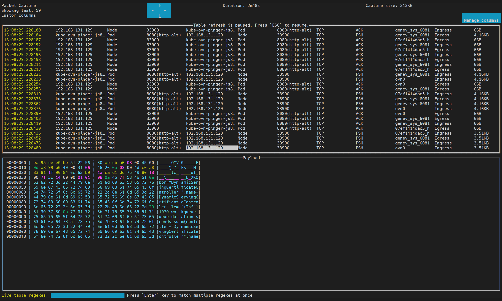
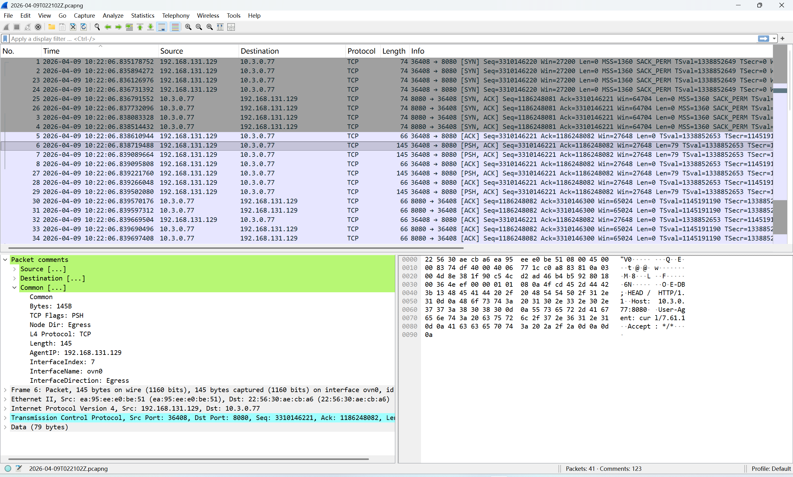
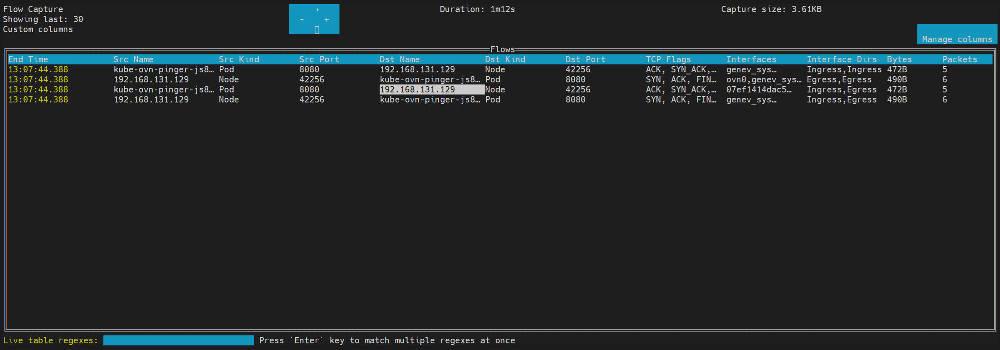

# Tasks for NetObserv

Use these tasks after [deploying NetObserv with the Operator](../observability/operator-deployment.mdx).
The first task uses the `kubectl-netobserv` CLI for an on-demand packet
capture. It is useful when a continuous flow query in the console does not
contain enough detail, or when you need a pcapng file for Wireshark.

## Prerequisites

- A kubeconfig with permission to create the temporary collector resources and
  read the target Pods.
- `kubectl`, Bash 4.2 or later, and `yq` 4.53 or later on the workstation.
- The `kubectl-netobserv` binary. The ACP NetObserv Operator package includes
  the binary and `yq` in the controller-manager image.

The CLI creates a temporary collector Pod and an eBPF agent DaemonSet. It does
not require a `FlowCollector` or ClickHouse to capture packets, but it requires
the collector and agent images to be available to the cluster. Run only one
capture in a namespace at a time; use `cleanup` after the output is saved.

## Task 1: Capture packets with the CLI

### Prepare the CLI

The following example copies the CLI and `yq` from the controller-manager Pod.
Use the fixed Operator namespace unless your package specifies another one.

```bash
CONTROLLER_POD=$(kubectl -n netobserv-operator get pod \
  -l app=netobserv-operator -o jsonpath='{.items[0].metadata.name}')
kubectl -n netobserv-operator cp "$CONTROLLER_POD:/kubectl-netobserv" \
  /usr/local/bin/kubectl-netobserv
kubectl -n netobserv-operator cp "$CONTROLLER_POD:/yq" /usr/local/bin/yq
chmod +x /usr/local/bin/kubectl-netobserv /usr/local/bin/yq

kubectl netobserv help
kubectl netobserv packets help
```

The CLI can also be run directly as `/usr/local/bin/kubectl-netobserv` when
the `kubectl` plugin directory is not in `PATH`.

### Command syntax and output

```text
kubectl netobserv packets [options]
```

Packet capture writes a pcapng file. Packets longer than 256 bytes are
truncated by the packet agent. The CLI adds Kubernetes metadata to packet
comments, including source and destination node, Pod, owner, network, MAC, and
port information. Capture files are copied to the `output/pcap` directory.

The default capture limit is five minutes or 50,000,000 bytes (50 MB),
whichever comes first. Set both limits explicitly for a reproducible incident
capture.

### Packet capture parameters

The following options are supported by `kubectl netobserv packets`. Use
`kubectl netobserv packets help` for the exact options in the installed build.

| Option | Description | Default or constraint |
| --- | --- | --- |
| `--background[=true\|false]` | Run the capture asynchronously and return after the collector starts. | `false` |
| `--copy[=true\|false\|prompt]` | Copy output automatically, skip copying, or ask after a foreground capture. | `prompt` |
| `--max-time=<duration>` | Stop after the duration, for example `30s`, `5m`, or `1h`. | `5m` |
| `--max-bytes=<size>` | Stop after the output reaches a byte limit, for example `50000000`, `500MB`, or `10G`. | `50000000` |
| `--ring-buffer-bytes=<size>` | Set the per-agent packet ring buffer, for example `2MiB` or `64K`. | `2MiB`; must be a non-zero power of two and a multiple of 4096; packets only |
| `--log-level=<level>` | Set component logging (`trace`, `debug`, `info`, `warn`, `error`, `fatal`, or `panic`). | `info` |
| `--node-selector=<key:value>` | Capture only on nodes matching the label. | All Linux nodes selected by the agent |
| `--cidr=<CIDR>` | Match an endpoint CIDR. | `0.0.0.0/0` |
| `--peer_ip=<IP>` | Match the peer IP. | Not set |
| `--peer_cidr=<CIDR>` | Match the peer CIDR. | Not set |
| `--protocol=<TCP\|UDP\|SCTP\|ICMP>` | Match the L4 protocol. | Not set |
| `--port=<port>` | Match either source or destination port. | Not set |
| `--ports=<port1,port2>` | Match either of two ports. | Not set |
| `--port_range=<start-end>` | Match a port range. | Not set |
| `--sport=<port>` / `--dport=<port>` | Match the source or destination port. | Not set |
| `--sports=<port1,port2>` / `--dports=<port1,port2>` | Match either of two source or destination ports. | Not set |
| `--sport_range=<start-end>` / `--dport_range=<start-end>` | Match a source or destination port range. | Not set |
| `--tcp_flags=<flag>` | Match a TCP flag such as `SYN`, `ACK`, `RST`, or `PSH`. | Not set |
| `--icmp_type=<type>` / `--icmp_code=<code>` | Match ICMP type or code. | Not set |
| `--action=<Accept\|Reject>` | Set the eBPF filter action. | `Accept` |
| `--enable_geneve[=true\|false]` | Decode Geneve-encapsulated traffic, such as Kube-OVN traffic. | `false` |
| `--enable_vxlan[=true\|false]` | Decode VXLAN-encapsulated traffic. | `false` |
| `--privileged[=true\|false]` | Force privileged eBPF agent mode when the CNI or capture path requires it. | Automatic |
| `--deployment=<namespace/name:port>` | Resolve the running Pods of a Deployment and match the specified port. Repeatable. | Not set |
| `--filter-map-entries=<count>` | Set the packet filter map capacity when using `--deployment`. | `16` Pod IP entries |

Packet capture must contain at least one eBPF filter. For example, add
`--protocol`, `--port`, `--cidr`, `--peer_ip`, or `--deployment`; an unrestricted
packet capture is rejected to avoid excessive resource consumption.

The `--deployment` form is useful for a load-balancer path:

```bash
kubectl netobserv packets \
  --deployment=shop/lb:80 \
  --deployment=shop/app:8080 \
  --protocol=TCP --max-time=2m --max-bytes=100MB
```

The CLI resolves Pod IPs when the command starts. Re-run the command after a
rollout. Targets are combined with OR, so the command matches traffic involving
either Deployment and is not limited to traffic between the two Deployments.
The default map capacity is 16 distinct Pod IPs; increase it explicitly when
the Deployments expand beyond that number:

```bash
kubectl netobserv packets \
  --deployment=shop/lb:80 --deployment=shop/app:8080 \
  --filter-map-entries=32 --protocol=TCP
```

Do not combine `--deployment` with the native CIDR, peer, port, or manual OR
filters. The CLI validates this before creating any capture resource.

### Foreground capture (TUI)

Use foreground mode for an interactive incident check. The command keeps the
terminal attached to the collector and displays a live TUI:

```bash
kubectl netobserv packets \
  --cidr=198.51.100.77/32 \
  --peer_ip=192.0.2.10 \
  --protocol=TCP --port=8080 \
  --max-time=2m --max-bytes=100MB
```

Use `Ctrl+C` to stop the TUI. The CLI then asks whether to copy the pcapng
file; add `--copy=true` to copy it without prompting. Use foreground mode when
the operator is watching the connection live and can keep a terminal attached.



After the copy completes, inspect the file with Wireshark or `tshark`:

```bash
ls -lh output/pcap/*.pcapng
tshark -r output/pcap/<capture>.pcapng
```

The packet timestamps in the pcapng file are not guaranteed to be sorted. Sort
by timestamp in Wireshark when reconstructing a path across nodes.



### Background capture

Use background mode when the problem is intermittent, the capture must run for
several minutes, or the terminal cannot remain attached. The collector Pod
continues running after the local command returns:

```bash
kubectl netobserv packets \
  --background=true --copy=false \
  --cidr=198.51.100.77/32 --peer_ip=192.0.2.10 \
  --protocol=TCP --port=8080 \
  --max-time=10m --max-bytes=500MB --ring-buffer-bytes=2MiB
```

Follow the capture and check its resources:

```bash
kubectl netobserv follow
kubectl -n netobserv-cli get pod/collector,daemonset/netobserv-cli
```

The CLI uses its configured capture namespace; set `NETOBSERV_NAMESPACE` when
the default is not suitable. When the time or byte limit is reached, the agent
DaemonSet is removed and the collector retains the output. To stop early, run
`kubectl netobserv stop`. Copy the output after the agent stops:

```bash
kubectl netobserv copy
ls -lh output/pcap/*.pcapng
kubectl netobserv cleanup
```

Run `cleanup` only after `copy` and any analysis are complete. It removes the
temporary CLI collector resources; it does not remove the Operator,
`FlowCollector`, ClickHouse, or application workloads.

### Capture flows instead of packets

When packet payloads are unnecessary, use `flows` to capture summarized flow
records. Foreground flow capture is displayed in a TUI and can be exported as
JSON or SQLite; background flow capture uses the same `follow`, `stop`, `copy`,
and `cleanup` lifecycle:

```bash
kubectl netobserv flows \
  --query='SrcK8S_Namespace=~"shop-.*"' \
  --protocol=TCP --port=8080 --max-time=5m
```



Flow-only features such as `--enable_pkt_drop`, `--enable_dns`, `--enable_rtt`,
`--enable_pkt_translation`, `--sampling`, and interface include/exclude filters
are available on `flows` (and `metrics`), not on `packets`. Use the installed
CLI's help output when a release adds or changes an option.
