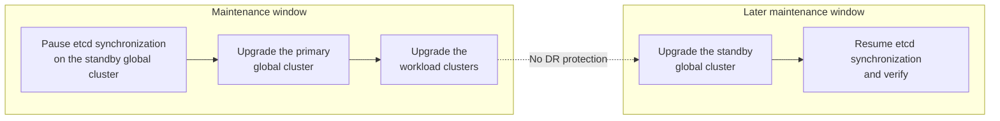

# Upgrade a Global DR Environment with a Deferred Standby Upgrade

This procedure upgrades the primary global cluster and the workload clusters of a global disaster recovery (DR) environment to a new patch release first, and upgrades the standby global cluster in place in a later maintenance window. It applies only when the standby global cluster cannot be upgraded in the same maintenance window as the primary global cluster. When both global clusters can be upgraded in one window, use [Upgrade Global Clusters in a DR Environment](./upgrade_global_dr.mdx) instead.



<Directive type="warning" title="Important">
This procedure supports only upgrades between **patch releases of the same minor version**, for example from ACP 4.5.1 to ACP 4.5.2.

Upgrades across minor versions, for example from ACP 4.5.1 to ACP 4.6.0, are **not supported** with this procedure. For those upgrades, follow [Upgrade Global Clusters in a DR Environment](./upgrade_global_dr.mdx).
</Directive>

<Directive type="warning" title="Important">
From the moment you pause etcd synchronization until verification after resume succeeds, the environment has **no disaster recovery protection**.

- Failover to the standby global cluster is not possible. Do not attempt a failover during this period.
- If the primary global cluster fails during this period, the standby global cluster cannot take over. Contact technical support.

Keep this period as short as possible. Schedule the standby upgrade window before you pause synchronization, and plan it as close to the primary upgrade as your change process allows.
</Directive>

## About Deferred Standby Upgrades \{#about}

In a standard DR upgrade, you uninstall **<Term name="product" /> etcd Synchronizer**, upgrade both global clusters in one window, and reinstall etcd Synchronizer. In a deferred standby upgrade, etcd Synchronizer stays installed on the standby global cluster and you **pause** and later **resume** it.

**Pause.** While paused, etcd Synchronizer keeps running but no longer reads from the primary global cluster and no longer writes to the standby etcd. The standby global cluster keeps the synchronized data as it was at the moment of the pause.

**Resume.** When you resume, etcd Synchronizer first copies all in-scope data from the primary global cluster. It then deletes in-scope keys that existed on the standby before the pause and no longer exist on the primary. Objects created locally on the standby after the pause are kept. Built-in safety checks skip or hold the deletion when the result is unexpected.

**Mixed-version period.** The period from the pause until verification after resume succeeds is called the *mixed-version period*. During this period, the primary global cluster and the standby global cluster run different patch releases, and the environment has no DR protection.

**Alauda OS global clusters.** If the global clusters run Alauda OS, the upgrade of each global cluster also includes [Upgrade Kubernetes on Alauda OS](./upgrade_kubernetes_on_alauda_os.mdx). Run it on the primary global cluster after its Distribution Version upgrade and before you upgrade the workload clusters. Run it on the standby global cluster in the standby upgrade window, after its Distribution Version upgrade and before you resume synchronization.

The upgrade runs in the following stages:

| Stage | Primary global cluster | Workload clusters | Standby global cluster | etcd Synchronizer on the standby | DR protection |
| --- | --- | --- | --- | --- | --- |
| Prepare | Source patch release | Source patch release | Source patch release | Pause-capable release, running | Yes |
| Pause | Source patch release | Source patch release | Source patch release, data frozen | Paused | **None** |
| Upgrade the primary and workload clusters | Target patch release, including Kubernetes on Alauda OS | Target patch release | Source patch release, data frozen | Paused | **None** |
| Upgrade the standby | Target patch release | Target patch release | Target patch release, including Kubernetes on Alauda OS | Target patch release, paused | **None** |
| Resume and verify | Target patch release | Target patch release | Target patch release | Target patch release, running | **None** until verification succeeds |

## Support Scope and Limitations \{#when-to-use}

### Supported Upgrades \{#supported-upgrades}

| Item | [Standard DR upgrade](./upgrade_global_dr.mdx) | Deferred standby upgrade (this page) |
| --- | --- | --- |
| Supported upgrades | All supported upgrade paths | Patch releases of the same minor version only, for example ACP 4.5.1 to ACP 4.5.2 |
| Upgrade order | Standby global cluster, then primary global cluster, in one window; workload clusters afterwards | Primary global cluster, then workload clusters; standby global cluster in a later window |
| How synchronization stops | etcd Synchronizer is uninstalled and later reinstalled | etcd Synchronizer stays installed, is paused, and is resumed |
| DR protection | None during the upgrade window | None for the whole mixed-version period |
| How the standby is upgraded | In place | In place |
| Alauda OS global clusters | [Upgrade Kubernetes on Alauda OS](./upgrade_kubernetes_on_alauda_os.mdx) runs on both global clusters after the Distribution Version upgrade | [Upgrade Kubernetes on Alauda OS](./upgrade_kubernetes_on_alauda_os.mdx) runs on the primary global cluster before the workload clusters are upgraded, and on the standby global cluster before synchronization is resumed |

This procedure applies to global clusters on Alauda OS and on other node operating systems.

The following upgrades are not supported with this procedure:

- Upgrades across minor versions, for example from ACP 4.5.1 to ACP 4.6.0. Use [Upgrade Global Clusters in a DR Environment](./upgrade_global_dr.mdx).
- Upgrades where the source patch release or the target patch release does not ship an etcd Synchronizer that supports pause mode. See the release notes.

### Restrictions During the Mixed-Version Period \{#restrictions}

From the moment you pause synchronization until verification after resume succeeds, the following restrictions apply:

- The environment has no DR protection. Do not fail over to the standby global cluster. If the primary global cluster fails, the standby global cluster cannot take over; contact technical support.
- Do not install new components, change plugins, or change configuration on **either** global cluster, except for the steps on this page and the procedures that it links to.
- Do not uninstall or reinstall etcd Synchronizer, and do not delete the ConfigMaps `kube-public/etcd-sync` or `cpaas-system/etcd-sync-control`.
- Do not restore the standby etcd from a snapshot and do not rebuild the standby etcd.
- Do not log in to the standby global cluster to perform management operations, such as node, cluster, or plugin operations. Run only the commands on this page and in the procedures that it links to, such as [Upgrade Kubernetes on Alauda OS](./upgrade_kubernetes_on_alauda_os.mdx) for the standby global cluster.
- Do not perform any workload cluster operation from the standby global cluster.
- Do not edit any `status.*` key of `cpaas-system/etcd-sync-control`. Only etcd Synchronizer writes these keys.

## Prerequisites \{#prerequisites}

The following requirements apply to the whole procedure. Each step of the [upgrade procedure](#procedure) lists the additional prerequisites for its stage. Run the commands on the **standby global cluster** unless stated otherwise. The [precheck script](#precheck-script) covers the items that can be read from the cluster.

- The source and target releases are **patch releases of the same minor version**, for example ACP 4.5.1 and ACP 4.5.2. Check the current version of both global clusters.
- Both the source patch release and the target patch release ship an etcd Synchronizer that supports pause mode. See the release notes.
- The standby global cluster can reach the primary global cluster API server at `https://<active-cluster-vip>:6443`. See [Checking access to the primary global cluster](#check-primary-access).
- The standby upgrade window is scheduled. See the [restrictions during the mixed-version period](#restrictions).

## Upgrade Procedure \{#procedure}

<Steps>

### Preparing the Global Clusters \{#prepare}

Prepare both global clusters so that the standby global cluster can be safely frozen at the pause.

**Prerequisites**

- All items in [Prerequisites](#prerequisites) are met.

**Procedure**

1. Record the versions of the global clusters and etcd Synchronizer with the change record.

2. Confirm that the standby global cluster is consistent with the primary global cluster. See [Checking synchronization status](#check-sync-status).

   If missed keys or surplus keys are reported, resolve or explain each key before you continue. Contact technical support when in doubt.

3. Run the [precheck script](#precheck-script) on the standby global cluster.

   If objects are being deleted, resolve them on the **primary** global cluster, for example by letting the deletion finish, and wait until the change is synchronized to the standby global cluster.

4. On **both** global clusters, confirm that no workload cluster Kubernetes or container runtime upgrade is in progress:

   ```bash
   kubectl -n cpaas-system get cvsh \
     -o jsonpath='{range .items[*]}{.metadata.name}{"\t"}{.status.conditions[?(@.type=="Reconciling")].status}{"\n"}{end}'
   ```

   No workload cluster reports `True`. If your release does not report the `Reconciling` condition, confirm in the Web Console that no cluster is upgrading.

5. On the **standby** global cluster, restart cluster-transformer:

   ```bash
   kubectl delete po -n cpaas-system -l service_name=cluster-transformer
   ```

6. Wait until the new cluster-transformer Pods are `Running`:

   ```bash
   kubectl get po -n cpaas-system -l service_name=cluster-transformer
   ```

7. On **both** global clusters, disable the token rotator of the Alauda cluster API provider, first on the standby global cluster and then on the primary global cluster. Otherwise, the workload cluster access tokens diverge while synchronization is paused: the standby global cluster can revoke tokens that the primary global cluster still uses, and the primary global cluster can rotate tokens that the frozen standby global cluster still holds.

   Run the following commands on each global cluster:

   ```bash
   kubectl -n cpaas-system set env deploy/cluster-api-provider-alauda-manager \
     -c cluster-api-provider-alauda CLUSTER_TOKEN_ROTATOR_ENABLED=false
   kubectl -n cpaas-system rollout status deploy/cluster-api-provider-alauda-manager
   ```

   On each global cluster, the platform records this change as a `ResourcePatch`, and `kubectl` prints `Warning: The operation is allowed, and ResourcePatch rp-<suffix> is created`. `ResourcePatch` objects are not synchronized between the global clusters. On each global cluster, find the `ResourcePatch` as described in [Finding the token rotator ResourcePatch](#token-rotator-resourcepatch) and record its name with the change record. You exempt each `ResourcePatch` before you upgrade its global cluster and remove it when you restore the baseline.

   The platform keeps one `ResourcePatch` for each target resource. If the creation time of the `ResourcePatch` is earlier than this step, it also holds earlier customizations of the Deployment. Record this with the change record.

**Verification**

- The precheck script reports no objects being deleted, and the token rotator value is `false`.
- On the primary global cluster, the token rotator value is `false`:

  ```bash
  kubectl -n cpaas-system get deploy cluster-api-provider-alauda-manager \
    -o jsonpath='{.spec.template.spec.containers[?(@.name=="cluster-api-provider-alauda")].env[?(@.name=="CLUSTER_TOKEN_ROTATOR_ENABLED")].value}{"\n"}'
  ```

- No workload cluster upgrade is in progress on either global cluster.

### Upgrading etcd Synchronizer to a Pause-Capable Release \{#upgrade-etcd-sync-patch}

Pause mode requires the etcd Synchronizer release for the source patch release that supports pause mode. If this release is already installed on the standby global cluster, skip this section. See the release notes to identify the release.

**Prerequisites**

- You have completed [Preparing the global clusters](#prepare).
- You have the etcd Synchronizer package of the pause-capable release.

**Procedure**

1. Publish the etcd Synchronizer package to the standby global cluster with `violet push`. See [Upload Packages](/extend/upload_package.mdx#violet_push_usage).
2. Access the Web Console of the **standby global cluster** through its VIP.
3. Switch to the **Administrator** view.
4. Navigate to **Marketplace > Cluster Plugins** and select the `global` cluster.
5. Find **<Term name="product" /> etcd Synchronizer** and upgrade it to the pause-capable release. Do not uninstall it; uninstalling removes the DR marker.
6. Wait until the plugin upgrade completes and the etcd Synchronizer Pods are `Running`:

   ```bash
   kubectl get po -n cpaas-system -l app=etcd-sync
   ```

7. Confirm that Lease `etcd-sync-mirror` has a holder and that the full synchronization has started on the leader:

   ```bash
   leader_pod=$(kubectl get lease -n cpaas-system etcd-sync-mirror -o jsonpath='{.spec.holderIdentity}')
   kubectl logs -n cpaas-system "$leader_pod" | grep -E "Acquired leader lease|Start Sync update"
   ```

8. Wait for the full synchronization to finish, then repeat [Checking synchronization status](#check-sync-status).
9. Run the [precheck script](#precheck-script) again.

**Verification**

- The etcd Synchronizer image tag is the pause-capable release.
- The synchronization status check reports no missed keys and no surplus keys, or each reported key is explained.
- The precheck script passes.

### Pausing etcd Synchronization \{#pause}

Pause etcd Synchronizer on the standby global cluster. The mixed-version period starts when the pause completes.

<Directive type="warning" title="Important">
After the pause, the environment has no DR protection until verification after resume succeeds. Do not fail over to the standby global cluster.
</Directive>

**Prerequisites**

- The etcd Synchronizer release on the standby global cluster supports pause mode.
- The precheck script and the synchronization status check passed after the last change to etcd Synchronizer.
- The standby upgrade window is scheduled.

**Procedure**

1. On the **standby** global cluster, create the control ConfigMap with `mode=Paused`. Use `reason` to record a change reference:

   ```bash
   kubectl -n cpaas-system create configmap etcd-sync-control \
     --from-literal=mode=Paused \
     --from-literal=reason="Deferred standby upgrade, change <change-reference>"
   ```

2. Wait until `mode`, `status.phase`, and `status.observedMode` are all `Paused`. The etcd Synchronizer container restarts once during the transition.

   ```bash
   kubectl -n cpaas-system get cm etcd-sync-control \
     -o jsonpath='{.data.mode}{" "}{.data.status\.phase}{" "}{.data.status\.observedMode}{"\n"}{.data.status\.message}{"\n"}'
   ```

   **Example output**

   ```text
   Paused Paused Paused
   ```

   The second line of the output shows `status.message`. It is empty unless etcd Synchronizer is waiting or has failed. `status.phase=Pausing` means that the pause is still in progress.

   <Directive type="danger" title="Warning">
   If `status.phase` and `status.observedMode` stay empty, the running etcd Synchronizer does not support pause mode and **synchronization is still running**. Do not upgrade the primary global cluster. Return to [Upgrading etcd Synchronizer to a pause-capable release](#upgrade-etcd-sync-patch).
   </Directive>

3. Record the pause result:

   ```bash
   kubectl -n cpaas-system get cm etcd-sync-control \
     -o jsonpath='{.data.status\.pausedAt}{" "}{.data.status\.pausedRevision}{" "}{.data.status\.etcdClusterID}{"\n"}'
   ```

   **Example output**

   ```text
   2026-11-02T02:00:05Z 58231904 14841639068965178418
   ```

   `status.pausedRevision` and `status.etcdClusterID` identify the standby etcd at the pause. On resume, etcd Synchronizer uses them to decide which keys can be deleted.

4. Review the pause self-check:

   ```bash
   kubectl -n cpaas-system get cm etcd-sync-control -o jsonpath='{.data.status\.pauseCheck}{"\n"}'
   ```

   **Example output**

   ```json
   {"checkedAt":"2026-11-02T02:00:09Z","sourceRevision":91234567,"candidates":81234,"unexpected":0,"samples":[]}
   ```

   The self-check is read-only. It applies the resume deletion rules at the time of the pause:

   - `unexpected` is the number of keys on the standby that would be deleted on resume because they do not exist on the primary. The expected value is `0`.
   - If `unexpected` is greater than `0`, review the keys in `samples`. They are usually objects that exist only on the standby or leftovers from earlier synchronization. If any of them must be kept, contact technical support before you continue.
   - If `error` is set, the self-check could not reach the primary global cluster. The pause is still in effect. Contact technical support if you need the self-check result before you continue.

5. Save the control ConfigMap with the change record:

   ```bash
   kubectl -n cpaas-system get cm etcd-sync-control -o yaml > etcd-sync-control-paused.yaml
   ```

6. Confirm that the DR marker still exists:

   ```bash
   kubectl -n kube-public get cm etcd-sync
   ```

   While paused, the `data.status` field of this ConfigMap can still show that synchronization is in progress. Use `cpaas-system/etcd-sync-control` as the source of truth for the pause state.

7. Run the [precheck script](#precheck-script) again and keep the output with the change record.

**Verification**

- `mode`, `status.phase`, and `status.observedMode` are all `Paused`.
- `status.pauseCheck` reports `unexpected` as `0`, or each sample key is explained.
- The DR marker `kube-public/etcd-sync` exists.

### Upgrading the Primary Global Cluster and Workload Clusters \{#upgrade-primary}

Upgrade the primary global cluster to the target patch release, then upgrade the workload clusters from the primary global cluster. If the global clusters run Alauda OS, upgrade Kubernetes on the primary global cluster before you upgrade the workload clusters.

**Prerequisites**

- etcd Synchronizer on the standby global cluster is `Paused`.
- The token rotator is disabled on the primary global cluster.
- If the global clusters run Alauda OS, the prerequisites of [Upgrade Kubernetes on Alauda OS](./upgrade_kubernetes_on_alauda_os.mdx) are met on the **primary** global cluster.

**Procedure**

1. On the **primary** global cluster, exempt the token rotator `ResourcePatch` for the target patch release. Otherwise, the preflight check `ResourcePatchUpgradeable` fails with `UnexemptResourcePatches` and blocks the upgrade. Use the `ResourcePatch` name that you recorded for the primary global cluster in [Preparing the global clusters](#prepare):

   ```bash
   kubectl annotate resourcepatches <rp-name> \
     config.cpaas.io/exempt-for-ver=<target-version> \
     --overwrite
   ```

   Alternatively, if you request the upgrade from **Web Console (Fleet Essentials)**, confirm the `ResourcePatch` on the **Custom Configuration** step. See **Request the upgrade** in [Upgrade the global cluster](./upgrade_global_cluster.mdx).

2. Upgrade the **primary** global cluster to the target patch release with the standard workflow in [Upgrade the global cluster](./upgrade_global_cluster.mdx): sync upgrade artifacts, run preflight checks, deploy the cluster version operator, request the upgrade, and observe execution until the primary global cluster reaches the target patch release.

   Administrator acknowledgements are not synchronized between global clusters, and an upgrade between patch releases can also require them, for example `ack-4.4-kubernetes-1.35-kernel-update`. Record the acknowledgements that the target patch release requires on the **primary** global cluster as described in [Handle Administrator Acknowledgement Gates](../troubleshooting.mdx#handle-administrator-acknowledgement-gates). You record them on the standby global cluster separately when you upgrade it.

   Do not run the steps of [Upgrade Global Clusters in a DR Environment](./upgrade_global_dr.mdx). In particular, do not uninstall or reinstall etcd Synchronizer on the standby global cluster.

3. If the global clusters run Alauda OS, run [Upgrade Kubernetes on Alauda OS](./upgrade_kubernetes_on_alauda_os.mdx) on the **primary** global cluster only, with the kubeconfig of the primary global cluster. You upgrade Kubernetes on the standby global cluster in the standby upgrade window.

   <Directive type="note" title="Note">
   During the rolling replacement, control plane nodes can be `NotReady` for a short time. This is expected.
   </Directive>

4. On the **primary** global cluster, confirm that the token rotator is still disabled:

   ```bash
   kubectl -n cpaas-system get deploy cluster-api-provider-alauda-manager \
     -o jsonpath='{.spec.template.spec.containers[?(@.name=="cluster-api-provider-alauda")].env[?(@.name=="CLUSTER_TOKEN_ROTATOR_ENABLED")].value}{"\n"}'
   ```

   If the value is not `false`, disable it again as described in [Preparing the global clusters](#prepare).

5. Upgrade the workload clusters from the **primary** global cluster by following [Upgrade Workload Clusters](../workload/upgrade_workload_cluster.mdx). In this procedure, only the primary global cluster must reach the target patch release, including the Kubernetes upgrade on Alauda OS, before the workload clusters are upgraded.

**Verification**

- The primary global cluster and the upgraded workload clusters report the target patch release.
- If the global clusters run Alauda OS, all nodes of the primary global cluster report the target Kubernetes version.
- The token rotator value on the primary global cluster is `false`.
- etcd Synchronizer on the standby global cluster is still `Paused`.

### Upgrading the Standby Global Cluster \{#upgrade-standby}

In the later maintenance window, upgrade the standby global cluster in place to the target patch release. During this upgrade, etcd Synchronizer moves to the target patch release and stays paused. If the global clusters run Alauda OS, also upgrade Kubernetes on the standby global cluster in this window, before you resume synchronization. Run the commands on the **standby** global cluster unless stated otherwise.

**Prerequisites**

- The primary global cluster has reached the target patch release. If the global clusters run Alauda OS, the Kubernetes upgrade of the primary global cluster is complete.
- etcd Synchronizer on the standby global cluster is `Paused`.
- You have the target patch release artifacts, including the **<Term name="product" /> etcd Synchronizer** package of the target patch release.
- If the global clusters run Alauda OS, the prerequisites of [Upgrade Kubernetes on Alauda OS](./upgrade_kubernetes_on_alauda_os.mdx) are met on the **standby** global cluster, including the infrastructure provider, the Cluster Bootstrap Provider, the Alauda OS image, and the etcd backup. These prerequisites apply to each global cluster separately. What you prepared on the primary global cluster is not synchronized to the standby global cluster while synchronization is paused.

**Procedure**

1. Run the [precheck script](#precheck-script). All items must pass. If the token rotator value is no longer `false`, disable it again as described in [Preparing the global clusters](#prepare).

2. Exempt the token rotator `ResourcePatch` for the target patch release. Otherwise, the preflight check `ResourcePatchUpgradeable` fails with `UnexemptResourcePatches` and blocks the upgrade.

   Use the `ResourcePatch` name that you recorded for the standby global cluster in [Preparing the global clusters](#prepare), or find it as described in [Finding the token rotator ResourcePatch](#token-rotator-resourcepatch), then add the exemption:

   ```bash
   kubectl annotate resourcepatches <rp-name> \
     config.cpaas.io/exempt-for-ver=<target-version> \
     --overwrite
   ```

   Alternatively, if you request the upgrade from **Web Console (Fleet Essentials)**, confirm the `ResourcePatch` on the **Custom Configuration** step. See **Request the upgrade** in [Upgrade the global cluster](./upgrade_global_cluster.mdx). For background on the exemption, see [Handle Preflight Blocks](../troubleshooting.mdx#handle-preflight-blocks-when-needed).

3. Publish the target patch release artifacts to the standby global cluster as described in [Sync upgrade artifacts](./upgrade_global_cluster.mdx#sync-upgrade-artifacts). Use the same registry type and target-version payload as for the primary global cluster.

4. Publish the etcd Synchronizer package of the target patch release to the standby global cluster with `violet push`. An inventory taken on the primary global cluster does not list etcd Synchronizer, because etcd Synchronizer is installed only on the standby global cluster.

5. [Check access to the primary global cluster](#check-primary-access). The etcd Synchronizer upgrade fails if the primary global cluster is not reachable or the token is not valid.

6. Record the administrator acknowledgements that the target patch release requires on the **standby** global cluster as described in [Handle Administrator Acknowledgement Gates](../troubleshooting.mdx#handle-administrator-acknowledgement-gates). Administrator acknowledgements are not synchronized between global clusters, so record them on the standby global cluster even if you recorded them on the primary global cluster.

7. Run the preflight checks with the target patch release package:

   ```bash
   bash upgrade.sh --preflight
   ```

   On the standby global cluster, preflight behaves as follows:

   - The additional check `DRSplitUpgradeWindow` confirms that etcd Synchronizer is paused, the DR marker exists, no objects are being deleted, and the token rotator is disabled. If it fails, see [`DRSplitUpgradeWindow` preflight failures](#drsplitupgradewindow).
   - `VersionUpgradePath` checks only the standby global cluster itself.
   - If `AdminAckRequired` fails, an acknowledgement is missing on the standby global cluster. Repeat the previous step.
   - If `ResourcePatchUpgradeable` fails, confirm the exemption of the token rotator `ResourcePatch` and of any other `ResourcePatch` that the message lists.

   On the standby global cluster, `upgrade.sh --preflight` might not print the check results. Read them from the `ClusterVersionShadow` of the standby global cluster with the commands in [Inspect Upgrade State](../troubleshooting.mdx#inspect-upgrade-state). To show only the `DRSplitUpgradeWindow` result:

   ```bash
   kubectl -n cpaas-system get cvsh global \
     -o jsonpath='{range .status.preflight.checks[?(@.name=="DRSplitUpgradeWindow")]}{.state}{"\t"}{.reason}{"\t"}{.message}{"\n"}{end}'
   ```

   The expected state is `Passed`.

8. Deploy the cluster version operator of the target patch release, request the upgrade, and observe execution as described in [Upgrade the global cluster](./upgrade_global_cluster.mdx). Do not request the upgrade before `upgrade.sh` has deployed the cluster version operator of the target patch release.

   The pre-upgrade etcd backup covers only the standby global cluster.

9. After the standby global cluster reaches the target patch release, confirm the etcd Synchronizer image and pause state:

   ```bash
   kubectl -n cpaas-system get deploy etcd-sync -o jsonpath='{.spec.template.spec.containers[*].image}{"\n"}'
   kubectl -n cpaas-system get cm etcd-sync-control \
     -o jsonpath='{.data.mode}{" "}{.data.status\.phase}{" "}{.data.status\.observedMode}{"\n"}'
   ```

   The image tag is the etcd Synchronizer release of the target patch release, and the second command returns `Paused Paused Paused`.

10. If etcd Synchronizer is still the earlier release, upgrade it to the target patch release from **Marketplace > Cluster Plugins** in the standby Web Console while it is paused. Then repeat the previous step. Do not resume synchronization with the earlier release.

11. If the global clusters run Alauda OS, run [Upgrade Kubernetes on Alauda OS](./upgrade_kubernetes_on_alauda_os.mdx) on the **standby** global cluster, with the kubeconfig of the standby global cluster. Keep etcd Synchronizer paused until the procedure and its verification are complete.

    <Directive type="note" title="Note">
    During the rolling replacement, control plane nodes can be `NotReady` for a short time. This is expected.
    </Directive>

    Replacing control plane nodes can change node addresses. Before you resume, [check the etcd endpoints](#check-etcd-endpoints).

12. Confirm that the token rotator is still disabled:

    ```bash
    kubectl -n cpaas-system get deploy cluster-api-provider-alauda-manager \
      -o jsonpath='{.spec.template.spec.containers[?(@.name=="cluster-api-provider-alauda")].env[?(@.name=="CLUSTER_TOKEN_ROTATOR_ENABLED")].value}{"\n"}'
    ```

    If the value is not `false`, disable it again as described in [Preparing the global clusters](#prepare).

**Verification**

- The standby global cluster reports the target patch release.
- If the global clusters run Alauda OS, all nodes of the standby global cluster report the target Kubernetes version.
- etcd Synchronizer is the target patch release, and `mode`, `status.phase`, and `status.observedMode` are all `Paused`.
- The token rotator value is `false`.

### Resuming etcd Synchronization \{#resume}

Resume etcd Synchronizer on the standby global cluster after the standby global cluster has reached the target patch release. The environment has no DR protection until [verification](#verify) succeeds.

**Prerequisites**

- The standby global cluster has reached the target patch release.
- etcd Synchronizer on the standby global cluster is the target patch release and is `Paused`.
- If the global clusters run Alauda OS, [Upgrade Kubernetes on Alauda OS](./upgrade_kubernetes_on_alauda_os.mdx) is complete on both global clusters.
- etcd Synchronizer on the standby global cluster can reach the standby etcd and the primary etcd endpoints that are configured in the plugin. See [Checking etcd endpoints](#check-etcd-endpoints).

**Procedure**

1. [Check access to the primary global cluster](#check-primary-access) again, and [check the etcd endpoints](#check-etcd-endpoints).

2. Set `mode=Running`:

   ```bash
   kubectl -n cpaas-system patch cm etcd-sync-control --type merge -p '{"data":{"mode":"Running"}}'
   ```

3. Wait until `status.phase` is `Running`:

   ```bash
   kubectl -n cpaas-system get cm etcd-sync-control \
     -o jsonpath='{.data.status\.phase}{"\n"}{.data.status\.message}{"\n"}'
   ```

   The phase changes to `Resuming` first, and the etcd Synchronizer container restarts once. Resume starts after the etcd Synchronizer start delay, which is 3 minutes by default. Its duration depends on the amount of synchronized data. If the phase stays `Resuming`, see [Resume does not complete](#resume-stuck).

4. Review the resume summary:

   ```bash
   kubectl -n cpaas-system get cm etcd-sync-control -o jsonpath='{.data.status\.lastResume}{"\n"}'
   ```

   **Example output**

   ```json
   {"startedAt":"2026-12-01T03:10:12Z","completedAt":"2026-12-01T03:14:47Z","sourceRevision":97810233,"putKeys":83012,"candidates":81234,"absentOnSource":42,"skippedByIgnore":3,"skippedByGuard":0,"deleted":39,"deleteSkipped":false,"deleteSkipReason":"","samples":["/registry/<resource>/<namespace>/<name>"]}
   ```

   Compare `deleted` and `samples` with the deletions made on the primary global cluster during the mixed-version period. For the meaning of each field, see [Resume summary fields](#resume-summary).

5. Check whether deletion is blocked for this pause cycle:

   ```bash
   kubectl -n cpaas-system get cm etcd-sync-control -o jsonpath='{.data.status\.deleteBlocked}{"\n"}'
   ```

   An empty result means that deletion was not blocked.

6. If `deleteSkipped` is `true`, check `deleteSkipReason`:

   - `ClusterIDChanged`, `RevisionRewound`, or `NoPauseRecord`: the standby etcd changed during the mixed-version period, for example it was restored from a snapshot or rebuilt, or the pause record was lost. etcd Synchronizer cannot safely determine which keys to delete, so it only copied data. The same reason is kept in `status.deleteBlocked`, and every retry in this pause cycle also skips deletion.

   Keys deleted on the primary global cluster during the mixed-version period can remain on the standby. Review them as surplus keys during [verification](#verify).

7. Save the resume summary with the change record.

### Verifying Synchronization and Restoring the Baseline \{#verify}

Verify that the standby global cluster is consistent with the primary global cluster, and restore the token rotator. The mixed-version period ends when this section completes successfully.

**Prerequisites**

- `status.phase` of `cpaas-system/etcd-sync-control` is `Running`.

**Procedure**

1. On the standby global cluster, run [Checking synchronization status](#check-sync-status).

2. If missed keys are reported, recreate the current etcd Synchronizer leader Pod and check again:

   ```bash
   leader_pod=$(kubectl get lease -n cpaas-system etcd-sync-mirror -o jsonpath='{.spec.holderIdentity}')
   kubectl delete po -n cpaas-system "$leader_pod"
   ```

3. Review every surplus key. Surplus keys can be leftovers from earlier synchronization, local standby objects, or keys that were not deleted on resume.

   <Directive type="danger" title="Warning">
   Do not delete surplus keys without confirming with technical support. Deleting the wrong keys on the standby global cluster can remove data that a failover depends on.
   </Directive>

4. On the standby global cluster, confirm that the `ClusterVersionShadow` objects of the workload clusters report the target patch release. These objects are synchronized from the primary global cluster.

   ```bash
   kubectl -n cpaas-system get cvsh \
     -o custom-columns='NAME:.metadata.name,CURRENT:.status.current.version,DESIRED:.status.desired.version'
   ```

   Each workload cluster that you upgraded from the primary global cluster reports the target patch release. The `global` entry describes the standby global cluster itself.

5. Remove the token rotator override on **both** global clusters, first on the primary global cluster and then on the standby global cluster. Run the following commands on each global cluster:

   ```bash
   kubectl -n cpaas-system set env deploy/cluster-api-provider-alauda-manager \
     -c cluster-api-provider-alauda CLUSTER_TOKEN_ROTATOR_ENABLED-
   kubectl -n cpaas-system rollout status deploy/cluster-api-provider-alauda-manager
   ```

6. On each global cluster, remove the token rotator `ResourcePatch`. Find it as described in [Finding the token rotator ResourcePatch](#token-rotator-resourcepatch). If it still exists and was created by the override in [Preparing the global clusters](#prepare), delete it:

   ```bash
   kubectl delete resourcepatches <rp-name> --ignore-not-found
   ```

   If the `ResourcePatch` also holds earlier customizations of the Deployment, do not delete it. Confirm with `kubectl get resourcepatches <rp-name> -o yaml` that it no longer contains `CLUSTER_TOKEN_ROTATOR_ENABLED`.

7. Keep `cpaas-system/etcd-sync-control` with `mode=Running`. It records the last pause and resume.

**Verification**

- The synchronization status check reports no missed keys, and each surplus key is explained.
- The `ClusterVersionShadow` objects of the upgraded workload clusters on the standby global cluster report the target patch release.
- The token rotator override is removed on both global clusters. On each global cluster, the following command returns an empty line:

  ```bash
  kubectl -n cpaas-system get deploy cluster-api-provider-alauda-manager \
    -o jsonpath='{.spec.template.spec.containers[?(@.name=="cluster-api-provider-alauda")].env[?(@.name=="CLUSTER_TOKEN_ROTATOR_ENABLED")].value}{"\n"}'
  ```

- On each global cluster, [Finding the token rotator ResourcePatch](#token-rotator-resourcepatch) lists no `ResourcePatch` for `cluster-api-provider-alauda-manager`, except one that holds earlier customizations and no longer contains `CLUSTER_TOKEN_ROTATOR_ENABLED`.

The mixed-version period ends here, and the standby global cluster provides DR protection again. Continue with [Upgrade Validation](../validation.mdx) and the [Routine Checks](/install/non_alauda_os/global_dr.mdx) of global DR.

</Steps>

## Reference \{#reference}

### Precheck Script \{#precheck-script}

The precheck script is read-only. Run it on the standby global cluster during preparation, after the pause, and at the start of the standby upgrade. Resource types that are not installed are skipped. Keep the output of each run with the change record.

| Section | What it checks | Expected result |
| --- | --- | --- |
| **Objects being deleted** | Cluster API objects, infrastructure provider machines, VMs and pools, `machine.alauda.io` MachinePools, BackupStorageLocationRepos, and MachineInventories that have a deletion timestamp. | No output. |
| **Token rotator** | The `CLUSTER_TOKEN_ROTATOR_ENABLED` value of the Alauda cluster API provider. | `false` after preparation. |
| **DR marker** | The ConfigMap `kube-public/etcd-sync`. | `configmap/etcd-sync`. |
| **etcd Synchronizer** | The image, the Lease holder, and the pause state in `cpaas-system/etcd-sync-control`. | The expected release; a Lease holder; `Paused Paused Paused` after the pause. |

```bash
#!/usr/bin/env bash
# Read-only checks for a deferred standby upgrade. Run on the standby global cluster.
set -uo pipefail

echo "== Objects being deleted (expected: no output) =="
available=$(kubectl api-resources -o name 2>/dev/null)
resources=(
  clusters.cluster.x-k8s.io machinedeployments.cluster.x-k8s.io machinesets.cluster.x-k8s.io
  machines.cluster.x-k8s.io machinepools.cluster.x-k8s.io
  kubeadmcontrolplanes.controlplane.cluster.x-k8s.io
  machinepools.machine.alauda.io
  backupstoragelocationrepoes.ait.velero.io
  machineinventories.elemental.cattle.io
)
# Every infrastructure provider kind that ends with Machine, VM, or Pool.
while read -r name kind; do
  [[ "$kind" =~ (Machine|VM|Pool)$ ]] && resources+=("${name}.infrastructure.cluster.x-k8s.io")
done < <(kubectl api-resources --api-group=infrastructure.cluster.x-k8s.io --no-headers 2>/dev/null \
  | awk '{print $1, $NF}')
for r in "${resources[@]}"; do
  grep -qx "$r" <<<"$available" || continue
  kubectl get "$r" -A \
    -o jsonpath='{range .items[?(@.metadata.deletionTimestamp)]}{.metadata.namespace}/{.metadata.name}{"\n"}{end}' \
    | sed "s|^|deleting $r: |"
done

echo "== Token rotator (expected: false) =="
kubectl -n cpaas-system get deploy cluster-api-provider-alauda-manager \
  -o jsonpath='{.spec.template.spec.containers[?(@.name=="cluster-api-provider-alauda")].env[?(@.name=="CLUSTER_TOKEN_ROTATOR_ENABLED")].value}{"\n"}'

echo "== DR marker (expected: configmap/etcd-sync) =="
kubectl -n kube-public get cm etcd-sync -o name

echo "== etcd Synchronizer =="
echo "image:"
kubectl -n cpaas-system get deploy etcd-sync -o jsonpath='{.spec.template.spec.containers[*].image}{"\n"}'
echo "leader:"
kubectl -n cpaas-system get lease etcd-sync-mirror -o jsonpath='{.spec.holderIdentity}{"\n"}'
echo "mode, status.phase, status.observedMode:"
kubectl -n cpaas-system get cm etcd-sync-control \
  -o jsonpath='{.data.mode}{" "}{.data.status\.phase}{" "}{.data.status\.observedMode}{"\n"}{.data.status\.pauseCheck}{"\n"}' \
  2>/dev/null || echo "control ConfigMap not created yet"
```

### Checking Synchronization Status \{#check-sync-status}

Compare the data on the standby global cluster with the primary global cluster through the etcd Synchronizer monitor.

**Procedure**

1. On the standby global cluster, query the `/check` endpoint of the monitor:

   ```bash
   mirror_svc=$(kubectl get svc -n cpaas-system etcd-sync-monitor -o jsonpath='{.spec.clusterIP}')
   ipv6_regex="^[0-9a-fA-F:]+$"
   if [[ $mirror_svc =~ $ipv6_regex ]]; then
     mirror_host="[$mirror_svc]"
   else
     mirror_host="$mirror_svc"
   fi
   curl -g "http://${mirror_host}/check"
   ```

2. Review the result. Missed keys exist on the primary but not on the standby. Surplus keys exist on the standby but not on the primary. For details, see [Routine Checks](/install/non_alauda_os/global_dr.mdx).

<Directive type="note" title="Note">
While etcd Synchronizer is paused, the result depends on the installed monitor. If the installed etcd Synchronizer monitor does not support pause detection, it keeps comparing both sides and reports many missed and surplus keys. This is expected. Releases that support pause detection return `paused: true` and the paused revision instead of a comparison, unless you request `/check?force=true`.
</Directive>

### Checking Access to the Primary Global Cluster \{#check-primary-access}

Upgrading etcd Synchronizer runs the `etcd-sync-bootstrap` Job, which reads the etcd CA from the primary global cluster with the active-cluster token. Resume also reads from the primary global cluster. Confirm on the standby global cluster that this access works.

**Procedure**

1. Set the primary global cluster VIP and the name of the Secret configured in **Active Global Cluster Token Secret**, which is usually `etcd-sync-active-cluster-token`:

   ```bash
   ACTIVE_VIP='<active-cluster-vip>'          # Use [<address>] for an IPv6 address.
   TOKEN_SECRET='etcd-sync-active-cluster-token'
   ```

2. Request the etcd CA Secret from the primary global cluster. The token is passed to `curl` through standard input and is not printed or stored:

   ```bash
   { printf 'Authorization: Bearer '
     kubectl -n cpaas-system get secret "$TOKEN_SECRET" -o jsonpath='{.data.token}' | base64 -d
     printf '\n'
   } | curl -sk -H @- -o /dev/null -w '%{http_code}\n' \
     "https://${ACTIVE_VIP}:6443/api/v1/namespaces/cpaas-system/secrets/etcd-ca"
   ```

   **Example output**

   ```text
   200
   ```

   | Result | Meaning |
   | --- | --- |
   | `200` | Access works. |
   | `401` | The token is no longer valid. |
   | `403` | The token lacks permission. |
   | `000` | The API server is not reachable. |

   If needed, refresh the token Secret as described in [Upgrade Global Clusters in a DR Environment](./upgrade_global_dr.mdx#global-dr-procedure). Updating the Secret does not change the pause state.

3. Confirm that cert-manager and the etcd client certificate on the standby global cluster are healthy:

   ```bash
   kubectl get po -n cert-manager
   kubectl get certificate -n cpaas-system remote-etcd-client
   ```

   All cert-manager Pods are `Running`, and the certificate is `READY=True`.

### Checking etcd Endpoints \{#check-etcd-endpoints}

etcd Synchronizer on the standby global cluster connects to the primary etcd through the endpoints in **Active Global Cluster ETCD Endpoints**, or through `https://<active-cluster-vip>:2379` when that parameter is empty. It connects to the standby etcd through **Standby Cluster ETCD Endpoints**. Replacing control plane nodes, for example with [Upgrade Kubernetes on Alauda OS](./upgrade_kubernetes_on_alauda_os.mdx), can change node addresses. Confirm that each configured endpoint still reaches the etcd of the corresponding global cluster.

**Procedure**

1. On the standby global cluster, list the configured endpoints:

   ```bash
   kubectl -n cpaas-system get deploy etcd-sync \
     -o jsonpath='{range .spec.template.spec.containers[*].command[*]}{@}{"\n"}{end}{range .spec.template.spec.containers[*].args[*]}{@}{"\n"}{end}' \
     | grep -E -- '^--(dest-)?endpoints='
   ```

   **Example output**

   ```text
   --endpoints=https://192.0.2.10:2379
   --dest-endpoints=https://etcd.kube-system:2379
   ```

   `--endpoints` lists the primary etcd endpoints, and `--dest-endpoints` lists the standby etcd endpoints.

2. Review each address:

   - A VIP, a load balancer address, or a Service name such as `etcd.kube-system` does not change when nodes are replaced.
   - A node address must belong to a current control plane node of the corresponding global cluster. Compare the `--endpoints` addresses with the control plane nodes of the primary global cluster, and the `--dest-endpoints` addresses with the control plane nodes of the standby global cluster:

     ```bash
     kubectl get nodes -l node-role.kubernetes.io/control-plane -o wide
     ```

3. If an endpoint refers to a node that no longer exists, update **Active Global Cluster ETCD Endpoints** or **Standby Cluster ETCD Endpoints** of **<Term name="product" /> etcd Synchronizer** in **Marketplace > Cluster Plugins** of the standby Web Console. For the parameters, see [Enable etcd Synchronization](/install/non_alauda_os/global_dr.mdx#etcd_sync). Do not uninstall etcd Synchronizer. Updating the plugin runs the `etcd-sync-bootstrap` Job, which requires [access to the primary global cluster](#check-primary-access). Then repeat this procedure.

4. Confirm that the etcd Synchronizer Pods and the monitor Pods are `Running` and do not restart repeatedly:

   ```bash
   kubectl get po -n cpaas-system -l app=etcd-sync
   kubectl get po -n cpaas-system -l app=etcd-sync-monitor
   ```

5. Run [Checking synchronization status](#check-sync-status). The monitor uses the same endpoints. If it returns a comparison result, both etcd endpoints are reachable, even if many missed and surplus keys are reported while paused. With a monitor that supports pause detection, request `/check?force=true`. If it returns an error instead, an endpoint is not reachable.

### Finding the Token Rotator ResourcePatch \{#token-rotator-resourcepatch}

The token rotator override from [Preparing the global clusters](#prepare) is recorded on each global cluster as a `ResourcePatch` that targets the Deployment `cpaas-system/cluster-api-provider-alauda-manager`. On the global cluster, list the `ResourcePatch` objects for this Deployment:

```bash
kubectl get resourcepatches \
  -o jsonpath='{range .items[?(@.spec.target.name=="cluster-api-provider-alauda-manager")]}{.metadata.name}{"\t"}{.spec.target.kind}{"\t"}{.spec.target.namespace}{"\t"}{.metadata.creationTimestamp}{"\t"}{.metadata.annotations.config\.cpaas\.io/exempt-for-ver}{"\n"}{end}'
```

**Example output**

```text
rp-7k2xq	Deployment	cpaas-system	2026-11-02T01:52:41Z	4.5.2
```

The columns are the `ResourcePatch` name, the target kind, the target namespace, the creation time, and the version that the `ResourcePatch` is exempted for. The last column is empty until you exempt the `ResourcePatch`. To review the recorded change, run `kubectl get resourcepatches <rp-name> -o yaml`.

### Control ConfigMap Reference \{#control-configmap-reference}

`cpaas-system/etcd-sync-control` exists only on the standby global cluster. It is not managed by the plugin and is not synchronized. etcd Synchronizer reads it every 5 seconds. If the ConfigMap has never been created, etcd Synchronizer runs normally.

Keys that you write:

| Key | Values | Description |
| --- | --- | --- |
| `mode` | `Running` or `Paused` (case-sensitive) | Requested state. |
| `reason` | Free text | Change reference for auditing. |

Keys that etcd Synchronizer writes (read-only):

| Key | Description |
| --- | --- |
| `status.phase` | Current state: `Running`, `Pausing`, `Paused`, or `Resuming`. |
| `status.observedMode` | The `mode` value that the current phase responds to. |
| `status.pausedAt` | Time the pause completed. |
| `status.pausedRevision` | Revision of the standby etcd at the pause. |
| `status.etcdClusterID` | Cluster ID of the standby etcd at the pause. |
| `status.pauseCheck` | JSON result of the self-check at the pause: `checkedAt`, `sourceRevision`, `candidates`, `unexpected`, `samples`, and `error`. |
| `status.lastResume` | JSON summary of the last resume. See [Resume summary fields](#resume-summary). |
| `status.deleteBlocked` | Set when deletion is disabled for the current pause cycle: `ClusterIDChanged`, `RevisionRewound`, or `NoPauseRecord`. Cleared by the next pause. |
| `status.message` | Reason for a wait or a failure. |
| `status.lastTransitionTime`, `status.holder` | Time of the last phase change, and the Pod that wrote the status. |

Changes to `mode` are ignored while the phase is `Pausing` or `Resuming`. They take effect after the transition completes.

### Resume Summary Fields \{#resume-summary}

| Field | Meaning | Expected |
| --- | --- | --- |
| `startedAt`, `completedAt` | Start and end time of the resume. | — |
| `sourceRevision` | Revision of the primary etcd that the resume copied from. | — |
| `putKeys` | Keys copied from the primary. | Greater than `0`. |
| `candidates` | Keys that existed on the standby before the pause and are in deletion scope. | — |
| `absentOnSource` | Candidates that no longer exist on the primary. | — |
| `skippedByIgnore` | Candidates kept because their value matches an ignore rule. | — |
| `skippedByGuard` | Candidates kept because they changed on the standby after the scan. | — |
| `deleted` | Keys deleted because they no longer exist on the primary, such as objects removed on the primary during the mixed-version period. | Consistent with the deletions made on the primary. |
| `deleteSkipped` | `true` if no keys were deleted on purpose. | `false` |
| `deleteSkipReason` | Why deletion was skipped: `ClusterIDChanged`, `RevisionRewound`, or `NoPauseRecord`. | Empty |
| `samples` | Up to 20 deleted keys. | — |

## Troubleshooting \{#troubleshooting}

### `DRSplitUpgradeWindow` Preflight Failures \{#drsplitupgradewindow}

`DRSplitUpgradeWindow` runs only when the `global` cluster that is being upgraded has the DR marker, that is, on the standby global cluster. Read its result with the command in [Upgrading the standby global cluster](#upgrade-standby) or the commands in [Inspect Upgrade State](../troubleshooting.mdx#inspect-upgrade-state).

| Reason | Cause | Action |
| --- | --- | --- |
| `EtcdSyncNotPaused` | `cpaas-system/etcd-sync-control` does not exist, or `mode`, `status.phase`, and `status.observedMode` are not all `Paused`. | If `status.phase` is `Pausing`, wait until it is `Paused` and rerun preflight. In all other cases, synchronization might have run during the mixed-version period. Stop and contact technical support. Do not pause or resume on your own. |
| `DRMarkerMissing` | `kube-public/etcd-sync` was removed, for example because etcd Synchronizer was uninstalled. | Stop and contact technical support. Do not reinstall etcd Synchronizer on your own. |
| `DeletingObjectsPresent` | Objects in the frozen standby data are being deleted. The message lists up to five of them. | Stop and contact technical support. These objects must be resolved before the pause. |
| `TokenRotatorEnabled` | The token rotator is enabled, or its rollout is not finished. | Disable it as described in [Preparing the global clusters](#prepare), wait for the rollout, and rerun preflight. |
| `DRSplitUpgradeWindowNotReady` | More than one of the above failed. The message lists each failed item with its reason. | Resolve each listed item. |
| `DependencyReadFailed` | An object or the API discovery could not be read. | Check the API server health of the standby global cluster and rerun preflight. This result is retried automatically. |

<Directive type="danger" title="Warning">
`DRSplitUpgradeWindow` blocks the upgrade by default. Setting `spec.desiredUpdate.force` on the `ClusterVersionShadow` lets the upgrade continue past a failed check and records the failure in `status.history[0].acceptedRisks`. A forced upgrade can leave the standby global cluster or workload clusters in a state that the platform has not validated. Use `force` only under the guidance of technical support. `DependencyReadFailed` cannot be forced.
</Directive>

### Resume Does Not Complete \{#resume-stuck}

If `status.phase` stays `Resuming`, read `status.message` and the current resume counters:

```bash
kubectl -n cpaas-system get cm etcd-sync-control \
  -o jsonpath='{.data.status\.message}{"\n"}{.data.status\.lastResume}{"\n"}'
```

**The primary global cluster is unreachable or a query failed.** No keys are deleted, and etcd Synchronizer retries automatically. Fix [access to the primary global cluster](#check-primary-access) and wait.

**Any other message.** Do not edit the control ConfigMap. Save the output of the command above and contact technical support.

### Other Symptoms \{#other-symptoms}

| Symptom | Explanation and action |
| --- | --- |
| `/check` reports many missed and surplus keys while paused. | Expected if the installed etcd Synchronizer monitor does not support pause detection. |
| `/check` returns `paused: true`. | Expected while paused with a monitor that supports pause detection. Use `/check?force=true` to run the comparison. |
| etcd Synchronizer Pods restart repeatedly while paused. | The active-cluster token or access to the primary global cluster is no longer valid. The pause state is kept, and nothing is written to the standby etcd. Fix [access to the primary global cluster](#check-primary-access) before you upgrade the standby global cluster. |
| `kube-public/etcd-sync` shows that synchronization is in progress while paused. | Expected. Use `cpaas-system/etcd-sync-control` for the pause state. |
| `upgrade.sh --preflight` on the standby global cluster does not print the check results. | Read the results from the `ClusterVersionShadow` with the commands in [Inspect Upgrade State](../troubleshooting.mdx#inspect-upgrade-state). |
| Preflight on a global cluster reports `ResourcePatchUpgradeable` with `UnexemptResourcePatches`. | Exempt the token rotator `ResourcePatch` of that global cluster for the target patch release, as described in [Upgrading the primary global cluster and workload clusters](#upgrade-primary) or [Upgrading the standby global cluster](#upgrade-standby). |

## Additional Resources \{#additional-resources}

- [Upgrade Overview](../overview.mdx)
- [Upgrade Global Clusters in a DR Environment](./upgrade_global_dr.mdx)
- [Upgrade the global cluster](./upgrade_global_cluster.mdx)
- [Upgrade Kubernetes on Alauda OS](./upgrade_kubernetes_on_alauda_os.mdx)
- [Upgrade Workload Clusters](../workload/upgrade_workload_cluster.mdx)
- [Upgrade Validation](../validation.mdx)
- [Upgrade Troubleshooting](../troubleshooting.mdx)
- [Global Cluster Disaster Recovery](/install/non_alauda_os/global_dr.mdx)
