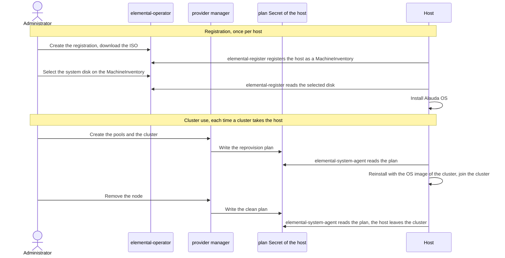

# Bare Metal Provider

The Infrastructure Provider for Bare Metal creates Alauda OS clusters directly on physical servers, without a virtualization layer. When you plan a cluster, note the following points that are specific to Bare Metal:

- The provider does not create machines. You register each host with the `global` cluster and list the hosts of each node group in a `MachineInventoryPool`; see [How It Works](#how-it-works). `ac` renders the cluster objects, but it does not register hosts or create pools.
- Hosts are registered independently of any cluster. One registration and its ISO serve all hosts of one OS and architecture, for every cluster; see [Prepare Alauda OS for Hosts](./prepare_os.mdx).
- A host stays registered for its whole life and moves between its pool and the cluster of the pool; see [How It Works](#how-it-works). Each pool holds at least as many hosts as the `replicas` of its node group; the extra hosts are spares.
- Each time a host is reinstalled, its Kubernetes state is cleared.
- A host keeps the network address that it had when it registered.
- The image catalog, `elemental-image-catalog`, must have a key for every Kubernetes version that a cluster uses, for the architecture and OS of its hosts; see [Add the Image Catalog Keys](./prepare_os.mdx#add-versions-to-image-catalog).
- The platform upgrade also upgrades Kubernetes and Alauda OS on these clusters. It first checks each cluster, and then upgrades it through every intermediate Kubernetes version that is staged in the image catalog; see [Who Upgrades Kubernetes](../../../upgrade/overview.mdx#upgrade-steps-by-node-os).
- The control plane endpoint is either a Self-built VIP on the control plane nodes (`internal`, the default) or your external load balancer.

## How It Works \{#how-it-works}

The `global` cluster never connects to a host. It writes what the host must do, the plan, to the host's plan Secret, and an agent on the host reads the plan and applies it.

A host goes through two stages:

- **Registration**, once per host and independent of workload clusters: the host boots the ISO and registers with the `global` cluster, which records it as a `MachineInventory`. The host then installs Alauda OS on the system disk that you select; the installed system runs the agent that receives the host's plans.
- **Cluster use**, each time a cluster takes the host from the `MachineInventoryPool` of one of its node groups: the host is reinstalled with the OS image that `elemental-image-catalog` maps to the Kubernetes version of the cluster, and joins the cluster. When the node is removed, the host stops Kubernetes and returns to its pool with its installed system unchanged, until a cluster takes it again.

A host connects to the platform address to register and to read its plans, and pulls the OS image from the registry of the cluster that it joins. A host of the `global` cluster reads its plans through the control plane endpoint instead; see [Registering Hosts for the global Cluster](../../../configure/nodes/alauda_os/bare-metal.mdx#global-hosts). For all network flows, see [Network Connectivity](./prerequisites.mdx#network-connectivity).

Four programs do this work: two that the Infrastructure Provider for Bare Metal plugin installs in `cpaas-system` on the `global` cluster, and two on each host:

| Component | Runs on | Role |
| --- | --- | --- |
| `elemental-operator` | `global` cluster | Builds the registration ISO and registers each host as a `MachineInventory`. |
| `cluster-api-provider-baremetal-manager`, the provider manager | `global` cluster | Takes hosts from the pools of a cluster and writes their plans: `reprovision` reinstalls the host and joins it to the cluster; `clean` stops Kubernetes on the host when its node is removed. |
| `elemental-register` | Host, booted from the ISO | Registers the host and installs Alauda OS on the selected system disk. |
| `elemental-system-agent` | Host, installed system | Reads the host's plan from the `global` cluster and applies it. |

During the installation of the `global` cluster, the same components run on the bootstrap cluster, and the hosts move to the `global` cluster at the end of the installation.

## `BaremetalMachine` Phases \{#baremetalmachine}

A `BaremetalMachine` moves through `Pending → Allocated → Reprovisioning → Running`. When it fails, it moves to `Failed`. When it is deleted, the provider cleans the host. Until the clean finishes, the `baremetal.alauda.io/allocation-state` annotation of its `MachineInventory` is `Preparing`; then it is `Available` again, free in its pool.

## Documentation

Read the pages in this order:

1. [Prerequisites](./prerequisites.mdx)
2. [Prepare Alauda OS for Hosts](./prepare_os.mdx)
3. [Register Hosts](./register_hosts.mdx)
4. [Create a Cluster](./create_cluster.mdx)
5. [Troubleshooting](./troubleshooting.mdx), when a creation stage does not advance
6. [Delete a Cluster](./deleting.mdx)

Related: [Parameters](./reference/install-config-parameters.mdx), [Manage Nodes](../../../configure/nodes/alauda_os/bare-metal.mdx), [Upgrade Overview](../../../upgrade/overview.mdx#upgrade-steps-by-node-os), [API Reference](../../../apis/kubernetes_apis/infrastructure_providers/bare-metal/index.mdx).
