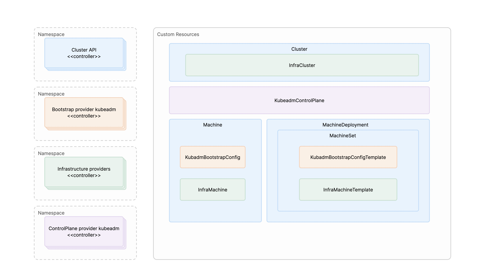

# Create a Cluster on Alauda OS

On this path, <Term name="productShort" /> creates clusters whose nodes run Alauda OS, an image-based, read-only operating system. The nodes are virtual machines on Huawei DCS, Huawei Cloud Stack, or VMware vSphere, or physical servers on Bare Metal.

## Architecture \{#architecture}

A cluster on Alauda OS is described by Cluster API objects on the `global` cluster. Two providers run on `global` and act on those objects:

- The **Alauda Container Platform Cluster Bootstrap Provider** turns machines into Kubernetes nodes with kubeadm and runs the control plane.
- An **infrastructure provider**, one for each IaaS platform, creates the machines from Alauda OS images. On Bare Metal, it reinstalls physical servers that you have registered instead of creating virtual machines.

### What `ac` Does and What the Platform Does \{#ac-and-the-platform}

You create a cluster with `ac adm alpha cluster create`. `ac` renders the Cluster API and provider objects from one `install-config.yaml`, checks them, and applies them to the `global` cluster. From then on, the providers on `global` create the machines and keep the cluster running. Node changes are covered in [Manage Nodes on Alauda OS Clusters](../../configure/nodes/alauda_os/index.mdx), and version changes in the upgrade documentation.

### Nodes Are Replaced, Not Changed in Place \{#nodes-are-replaced}

A Kubernetes or Alauda OS version change replaces the nodes one at a time. On Huawei DCS, Huawei Cloud Stack, and VMware vSphere, each node is replaced with a new virtual machine. On Bare Metal, the existing hosts are reinstalled; a host removed from the cluster returns to its pool, and its declared data volumes stay with that host. Supported OS settings are changed through [Machine Configuration](../../configure/machine_config/index.mdx).

With fewer than three control plane nodes, contact technical support before you upgrade the cluster.

| Data | When a node is replaced |
| --- | --- |
| Data on the node's own disks, such as `hostPath` volumes and local PersistentVolumes, unless they are on pool-managed persistent disks (Bare Metal: declared data volumes) | Not kept. Keep data that must survive on CSI storage or on a pool-managed persistent disk. |
| Data on pool-managed persistent disks (Huawei DCS, Huawei Cloud Stack, VMware vSphere) and on declared data volumes (Bare Metal), such as the platform data in `/var/cpaas` | Kept when the replacement node takes over the pool entry or host of the node it replaces. |
| External storage, such as volumes provided through CSI | Not affected. |

### Fixed at Creation \{#fixed-at-creation}

Decide the following before you create the cluster. They cannot be changed on an existing cluster:

- The control plane endpoint mode and address. See [Plan the Control Plane Endpoint](./prepare/control-plane-endpoint.mdx).
- The image registry of the cluster: the registry of the `global` cluster or a dedicated one. See [Choose the Image Registry for a Workload Cluster](./prepare/workload-cluster-image-registry.mdx).
- On Huawei DCS and Huawei Cloud Stack, the layout of an existing persistent disk, such as its size and, on Huawei DCS, its datastore. Plan the disks of each node pool before you create the cluster.

## Supported Providers \{#supported-providers}

| Provider | Machines | Control plane endpoint | Create with | Notable for planning |
|---|---|---|---|---|
| [Bare Metal](./bare-metal/overview.mdx) | Physical servers that register once from an installation ISO built by the platform and are listed per node group in a pool | Self-built VIP (default), or an external load balancer | `ac` | You register the hosts and create the pools before you run `ac`. |
| [Huawei DCS](./huawei-dcs/overview.mdx) | Virtual machines cloned from a DCS VM template | External load balancer (default), or a Self-built VIP | `ac`, or the web UI with Fleet Essentials | Each node has a fixed address and hostname that you reserve; DCS does not reserve them. The Kubernetes version comes from the VM template. |
| [Huawei Cloud Stack](./huawei-cloud-stack/overview.mdx) | ECS instances in an existing VPC, subnet, and security group | An HCS ELB that the provider creates | `ac`, or the web UI with Fleet Essentials `1.0.2` or later | Each node pool is placed in one availability zone. The ELB takes one VIP and two L4 and two L7 addresses. |
| [VMware vSphere](./vmware-vsphere/overview.mdx) | Virtual machines cloned from a vSphere VM template, each with a static IP address and hostname from `install-config.yaml` (no DHCP) | External load balancer (default), or a Self-built VIP | `ac` | Every node group needs its own machine config pool. A dedicated image registry is not available. |

### Control Plane Endpoint \{#control-plane-endpoint}

The Kubernetes API server of each cluster is reached on port `6443` through one stable endpoint: a VIP that the provider keeps on the control plane nodes (Self-built VIP), an external load balancer that you run, or, on Huawei Cloud Stack, an ELB that the provider creates. What to prepare for each mode is in [Plan the Control Plane Endpoint](./prepare/control-plane-endpoint.mdx).

### Web UI Support (Fleet Essentials) \{#fleet-essentials}

Fleet Essentials is a cluster plugin that adds cluster creation and node pool pages to the web UI for some providers:

- **Huawei DCS**: see [Create in the Web UI](./huawei-dcs/create_cluster.mdx#create-in-web-ui).
- **Huawei Cloud Stack**: with Fleet Essentials `1.0.2` or later; see [Create in the Web UI](./huawei-cloud-stack/create_cluster.mdx#create-in-web-ui).
- **Bare Metal** and **VMware vSphere**: there is no web UI for cluster creation; use `ac`.

## Install the Providers on the global Cluster \{#install-providers}

Before you create a workload cluster on Bare Metal, Huawei DCS, Huawei Cloud Stack, or VMware vSphere, install the infrastructure provider for that IaaS platform, together with the Cluster Bootstrap Provider, on the `global` cluster. A `global` cluster installed with `ac` already runs the Cluster Bootstrap Provider and the provider of its own platform. See [Install the Infrastructure Provider](./prepare/index.mdx#install-the-provider).

Upgrading Kubernetes on an Alauda OS `global` cluster also requires the provider for that IaaS platform to be uploaded and installed on the `global` cluster first.

## Cluster Creation Workflow \{#workflow}

Create a workload cluster on Alauda OS in the following order. [Prepare](./prepare/index.mdx) describes the first three steps in the same order.

1. **Install the Provider**: Install the provider for your IaaS platform, and the Cluster Bootstrap Provider, on the `global` cluster.
2. **Infrastructure Resources**: Prepare what the provider requires, as listed in its Prerequisites page. With `ac`, this is mainly the credential Secret and the IaaS objects that `install-config.yaml` names.
3. **Plan the Cluster**: Read [Prepare](./prepare/index.mdx) for the decisions that apply to every provider, such as the control plane endpoint mode and the image registry of the cluster. Also check the following before you create the cluster:
   - **Node Labels and Taints**: If dedicated node pools (monitoring, logging, ingress) are planned, read how to declare role labels and taints on the pool in [Infra Nodes](../../configure/nodes/node_planning.mdx#create-infra-nodes-alauda-os) before creating the pools.
   - **CPU Baseline**: For x86_64 cluster nodes that use ACP-provided Alauda OS images, the underlying CPUs must support the `x86-64-v2` ISA baseline. For details, see [OS Support Matrix](../../overview/alauda_os_support_matrix.mdx).
4. **Create a Cluster**: Create the cluster, including its first worker nodes, with `ac adm alpha cluster create` from one `install-config.yaml`.

Each provider has its own pages for these steps:

| Provider | Overview | Prerequisites | Create | Delete | Troubleshooting | Reference |
|---|---|---|---|---|---|---|
| Bare Metal | [Overview](./bare-metal/overview.mdx) | [Prerequisites](./bare-metal/prerequisites.mdx) | [Create](./bare-metal/create_cluster.mdx) | [Delete](./bare-metal/deleting.mdx) | [Troubleshooting](./bare-metal/troubleshooting.mdx) | [Reference](./bare-metal/reference/index.mdx) |
| Huawei DCS | [Overview](./huawei-dcs/overview.mdx) | [Prerequisites](./huawei-dcs/prerequisites.mdx) | [Create](./huawei-dcs/create_cluster.mdx) | [Delete](./huawei-dcs/deleting.mdx) | [Troubleshooting](./huawei-dcs/troubleshooting.mdx) | [Reference](./huawei-dcs/reference/index.mdx) |
| Huawei Cloud Stack | [Overview](./huawei-cloud-stack/overview.mdx) | [Prerequisites](./huawei-cloud-stack/prerequisites.mdx) | [Create](./huawei-cloud-stack/create_cluster.mdx) | [Delete](./huawei-cloud-stack/deleting.mdx) | [Troubleshooting](./huawei-cloud-stack/troubleshooting.mdx) | [Reference](./huawei-cloud-stack/reference/index.mdx) |
| VMware vSphere | [Overview](./vmware-vsphere/overview.mdx) | [Prerequisites](./vmware-vsphere/prerequisites.mdx) | [Create](./vmware-vsphere/create_cluster.mdx) | [Delete](./vmware-vsphere/deleting.mdx) | [Troubleshooting](./vmware-vsphere/troubleshooting.mdx) | [Reference](./vmware-vsphere/reference/index.mdx) |

If a failure is not provider-specific, see [Troubleshooting](./troubleshooting/index.mdx).

## Related Tasks \{#related-tasks}

| Scenario | Documentation |
|----------|---------------|
| Install the `global` cluster on Alauda OS | [Installing the global Cluster](../../install/alauda_os/index.mdx) |
| Plan disaster recovery for the `global` cluster | [Global Cluster Disaster Recovery](../../install/alauda_os/disaster_recovery.mdx) |
| Upgrade the `global` cluster | [Upgrade the Distribution Version](../../upgrade/global/upgrade_global_cluster.mdx), then [Upgrade Kubernetes on Alauda OS](../../upgrade/global/upgrade_kubernetes_on_alauda_os.mdx) |
| Upgrade workload clusters | [Upgrade the Distribution Version](../../upgrade/workload/upgrade_workload_cluster.mdx), then [Upgrade Kubernetes on Alauda OS](../../upgrade/workload/alauda_os/index.mdx) |
| Manage cluster nodes | [Manage Nodes on Alauda OS Clusters](../../configure/nodes/alauda_os/index.mdx) |
| Configure machines (OS or kernel level) | [Machine Configuration](../../configure/machine_config/index.mdx) |
| Look up Cluster API and provider resources | [Cluster API Reference](../../apis/kubernetes_apis/cluster_api/index.mdx) and [Provider APIs](../../apis/kubernetes_apis/infrastructure_providers/index.mdx) |

<Overview overviewHeaders={[]} />
