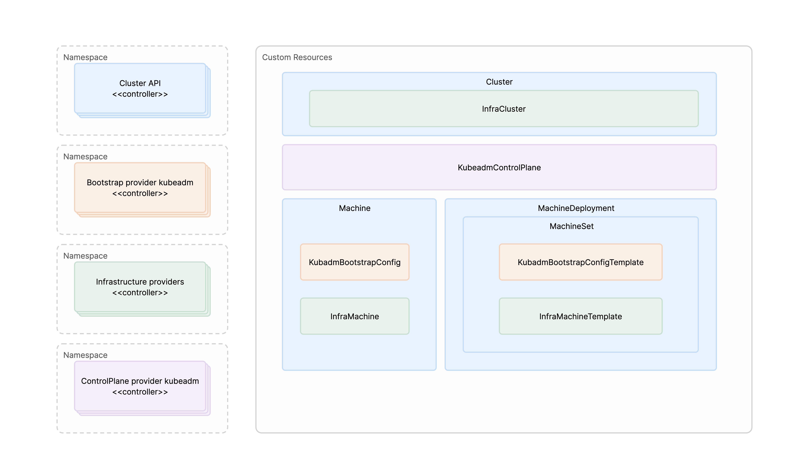

# Create a Cluster on Alauda OS

On this path, <Term name="productShort" /> creates clusters whose nodes run Alauda OS, an image-based, read-only operating system. On Huawei DCS, Huawei Cloud Stack, and VMware vSphere, the nodes are virtual machines. On Bare Metal, they are physical servers.

## Architecture \{#architecture}

Cluster API objects on the `global` cluster describe a cluster on Alauda OS. Two providers run on `global` and act on those objects:

- The **Alauda Container Platform Cluster Bootstrap Provider** turns machines into Kubernetes nodes with kubeadm and runs the control plane.
- An **infrastructure provider** creates the machines from Alauda OS images. There is one for each IaaS platform. On Bare Metal, the provider does not create virtual machines. It reinstalls the physical servers that you registered.

### What `ac` Does and What the Platform Does \{#ac-and-the-platform}

You create a cluster with `ac adm alpha cluster create`. `ac` renders the Cluster API and provider objects from one `install-config.yaml`, checks them, and applies them to the `global` cluster. From then on, the providers on `global` create the machines and keep the cluster running. For node changes, see [Manage Nodes on Alauda OS Clusters](../../configure/nodes/alauda_os/index.mdx). For version changes, see the upgrade documentation.

### Nodes Are Replaced, Not Changed in Place \{#nodes-are-replaced}

A Kubernetes or Alauda OS version change replaces the nodes one at a time. On Huawei DCS, Huawei Cloud Stack, and VMware vSphere, each node is replaced with a new virtual machine. On Bare Metal, the existing hosts are reinstalled, and a host that is removed from the cluster returns to its pool. To change supported OS settings, use [Machine Configuration](../../configure/machine_config/index.mdx).

A cluster with a single control plane node is for testing and cannot be upgraded.

| Data | When a node is replaced |
| --- | --- |
| Data on the node's own disks, such as `hostPath` volumes and local PersistentVolumes, except data on pool-managed persistent disks | Not kept. Store data that must survive on CSI storage or on a pool-managed persistent disk. |
| Data on pool-managed persistent disks (Huawei DCS, Huawei Cloud Stack, VMware vSphere), such as the platform data in `/var/cpaas` | Kept when the replacement node takes over the pool entry of the node it replaces. |
| External storage, such as volumes provided through CSI | Not affected. |

### Fixed at Creation \{#fixed-at-creation}

Decide the following before you create the cluster, because you cannot change them on an existing cluster:

- The control plane endpoint mode and address. See [Plan the Control Plane Endpoint](../../install/alauda_os/prerequisites.mdx#control-plane-endpoint).
- The image registry of the cluster, which is either the registry of the `global` cluster or a dedicated registry. See [Choose the Image Registry for a Workload Cluster](./prepare/workload-cluster-image-registry.mdx).
- On Huawei DCS, Huawei Cloud Stack, and VMware vSphere, the layout of an existing persistent disk, such as its size and, on Huawei DCS, its datastore. On VMware vSphere, the addresses and disks of a pool slot also cannot be changed once a machine takes the slot. Plan the disks of each node pool before you create the cluster.

## Supported Providers \{#supported-providers}

| Provider | Machines | Control plane endpoint | Notable for planning |
|---|---|---|---|
| [Bare Metal](./bare-metal/overview.mdx) | Physical servers that register once from an installation ISO built by the platform. You list them in a pool for each node group | Self-built VIP (default), or an external load balancer | Prepare the OS and register the hosts once, independently of any cluster. Then create the pools from available hosts before you run `ac`. |
| [Huawei DCS](./huawei-dcs/overview.mdx) | Virtual machines cloned from a DCS VM template | External load balancer (default), or a Self-built VIP | Each node has a fixed address and hostname. You reserve them; DCS does not. The Kubernetes version comes from the VM template. |
| [Huawei Cloud Stack](./huawei-cloud-stack/overview.mdx) | ECS instances in an existing VPC, subnet, and security group | An HCS ELB that the provider creates | Each node pool is in one availability zone. The ELB uses one VIP, two L4 addresses, and two L7 addresses. |
| [VMware vSphere](./vmware-vsphere/overview.mdx) | Virtual machines cloned from a vSphere VM template, each with a static IP address and hostname from `install-config.yaml` (DHCP is not used) | External load balancer (default), or a Self-built VIP | Every node group needs its own machine config pool. |

### Control Plane Endpoint \{#control-plane-endpoint}

For what to prepare for each endpoint mode, see [Plan the Control Plane Endpoint](../../install/alauda_os/prerequisites.mdx#control-plane-endpoint).

## Install the Providers on the global Cluster \{#install-providers}

Install two providers on the `global` cluster: the provider for your IaaS platform and the Cluster Bootstrap Provider. Follow [Install the Infrastructure Provider](./prepare/index.mdx#install-the-provider). A `global` cluster installed with `ac` already runs the Cluster Bootstrap Provider and the provider of its own platform.

Before you upgrade Kubernetes on an Alauda OS `global` cluster, upload and install the provider for that IaaS platform on the `global` cluster.

## Cluster Creation Workflow \{#workflow}

Follow these steps to create a workload cluster on Alauda OS. [Prepare](./prepare/index.mdx) describes the first three steps in the same order.

1. **Install the Provider**: Install the provider for your IaaS platform, and the Cluster Bootstrap Provider, on the `global` cluster.
2. **Infrastructure Resources**: Prepare what the provider requires, as listed on its Prerequisites page. With `ac`, this is mainly the credential Secret and the IaaS objects that `install-config.yaml` names. On Bare Metal, this means the OS images, the registrations, and the registered hosts; see [Prepare Alauda OS for Hosts](./bare-metal/prepare_os.mdx) and [Register Hosts](./bare-metal/register_hosts.mdx).
3. **Plan the Cluster**: Read [Prepare](./prepare/index.mdx) for the decisions that apply to every provider, such as the control plane endpoint mode and the image registry of the cluster. Also check the following before you create the cluster:
   - **Node Labels and Taints**: If you plan dedicated node pools (monitoring, logging, ingress), read [Infra Nodes](../../configure/nodes/node_planning.mdx#create-infra-nodes-alauda-os) before you create the pools. It explains how to declare role labels and taints on a pool.
   - **CPU Baseline**: For x86_64 cluster nodes that use ACP-provided Alauda OS images, the underlying CPUs must support the `x86-64-v2` ISA baseline. For details, see [OS Support Matrix](../../overview/alauda_os_support_matrix.mdx).
4. **Create a Cluster**: Create the cluster, including its first worker nodes, with `ac adm alpha cluster create` from one `install-config.yaml`.

Each provider has its own pages for these steps:

| Provider | Overview | Prerequisites | Create | Delete | Troubleshooting | Reference |
|---|---|---|---|---|---|---|
| Bare Metal | [Overview](./bare-metal/overview.mdx) | [Prerequisites](./bare-metal/prerequisites.mdx), [Prepare Alauda OS](./bare-metal/prepare_os.mdx), [Register Hosts](./bare-metal/register_hosts.mdx) | [Create](./bare-metal/create_cluster.mdx) | [Delete](./bare-metal/deleting.mdx) | [Troubleshooting](./bare-metal/troubleshooting.mdx) | [Reference](./bare-metal/reference/index.mdx) |
| Huawei DCS | [Overview](./huawei-dcs/overview.mdx) | [Prerequisites](./huawei-dcs/prerequisites.mdx) | [Create](./huawei-dcs/create_cluster.mdx) | [Delete](./huawei-dcs/deleting.mdx) | [Troubleshooting](./huawei-dcs/troubleshooting.mdx) | [Reference](./huawei-dcs/reference/index.mdx) |
| Huawei Cloud Stack | [Overview](./huawei-cloud-stack/overview.mdx) | [Prerequisites](./huawei-cloud-stack/prerequisites.mdx) | [Create](./huawei-cloud-stack/create_cluster.mdx) | [Delete](./huawei-cloud-stack/deleting.mdx) | [Troubleshooting](./huawei-cloud-stack/troubleshooting.mdx) | [Reference](./huawei-cloud-stack/reference/index.mdx) |
| VMware vSphere | [Overview](./vmware-vsphere/overview.mdx) | [Prerequisites](./vmware-vsphere/prerequisites.mdx) | [Create](./vmware-vsphere/create_cluster.mdx) | [Delete](./vmware-vsphere/deleting.mdx) | [Troubleshooting](./vmware-vsphere/troubleshooting.mdx) | [Reference](./vmware-vsphere/reference/index.mdx) |

If a failure is not provider-specific, see [Troubleshooting](./troubleshooting/index.mdx).

## Related Tasks \{#related-tasks}

| Scenario | Documentation |
|----------|---------------|
| Install the `global` cluster on Alauda OS | [Installing the global Cluster](../../install/alauda_os/index.mdx) |
| Plan disaster recovery for the `global` cluster | [Create a Global Cluster Disaster Recovery Pair](../../install/alauda_os/global_dr.mdx) |
| Learn how Kubernetes and Alauda OS are upgraded on each provider | [Who Upgrades Kubernetes](../../upgrade/overview.mdx#upgrade-steps-by-node-os) |
| Upgrade the `global` cluster | [Upgrade the global Cluster](../../upgrade/global/upgrade_global_cluster.mdx) |
| Upgrade workload clusters | [Upgrade Workload Clusters](../../upgrade/workload/upgrade_workload_cluster.mdx) |
| Manage cluster nodes | [Manage Nodes on Alauda OS Clusters](../../configure/nodes/alauda_os/index.mdx) |
| Configure machines (OS or kernel level) | [Machine Configuration](../../configure/machine_config/index.mdx) |
| Look up Cluster API and provider resources | [Cluster API Reference](../../apis/kubernetes_apis/cluster_api/index.mdx) and [Provider APIs](../../apis/kubernetes_apis/infrastructure_providers/index.mdx) |

<Overview overviewHeaders={[]} />
